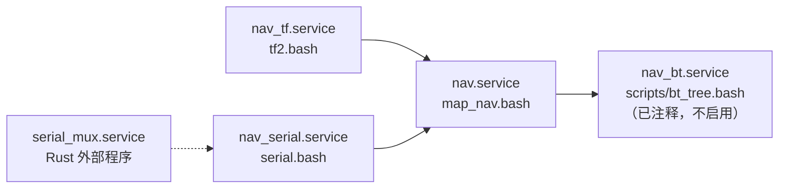
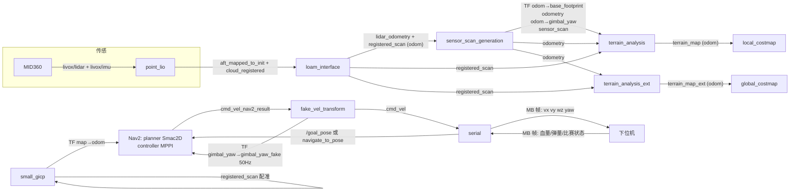
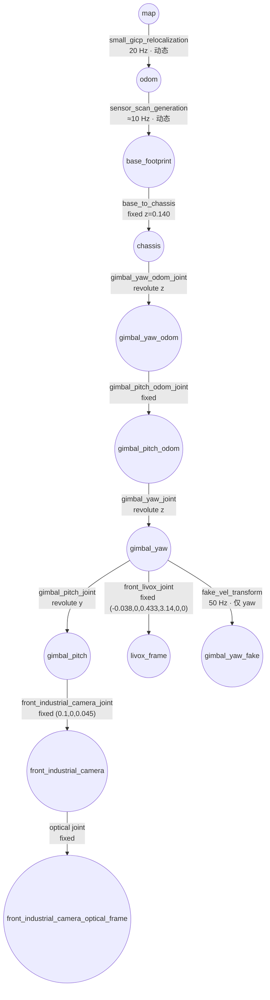
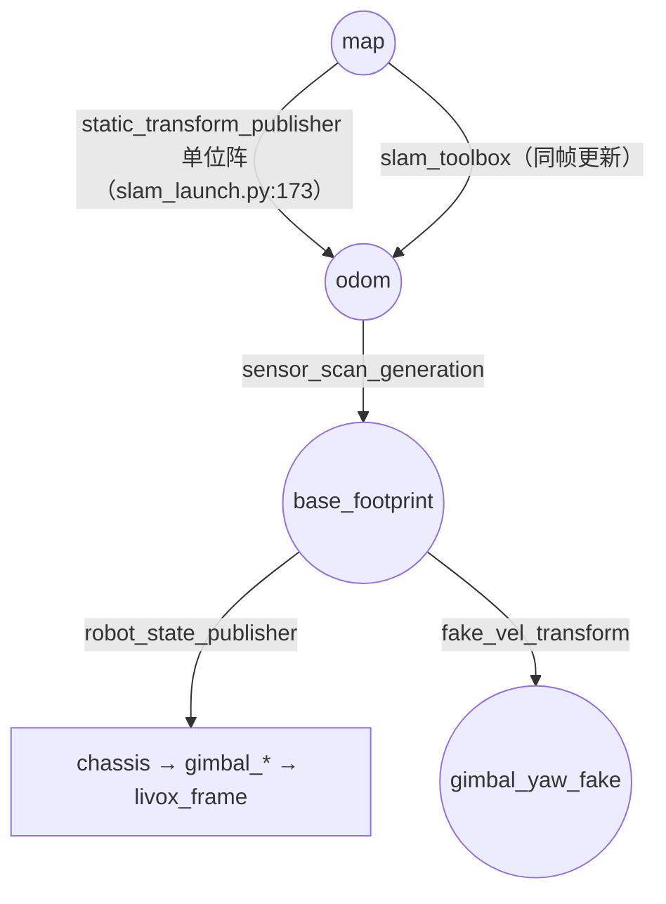

# NavX 项目分析：ROS 2 功能包与 TF 构成

> **分析对象**：`/home/xyt/NavX`（分支 `rmuc2026_dev`，HEAD `4919323`）
> **分析时间**：2026-11-07
> **依据**：`src/` 源码、launch、yaml、xacro/SDF、脚本；不含 `build/`、`install/` 生成物。
> **约定**：标 **已核实** 的结论有源码行号支撑；标 **推测** 的是从代码结构推断、未实测；标 **待确认** 的需要你确认后我再补写。
> **后续**：精简改造方案见 [docs/tf_simplification_plan.md](docs/tf_simplification_plan.md)（目标 TF 只保留 `map → odom → base_link → livox_frame`）。
> **规模**：`src/` 下共 30 个 `package.xml`（`src/location/z-localization` 为新引入的独立 git 子工程，含 5 个包）。

---

## 0. 一句话结论

NavX 是一套 **RoboMaster 哨兵/步兵的 Nav2 导航工作区**，定位链路是
**Livox MID360（倾斜安装） → Point-LIO（激光惯性里程计） → loam_interface（雷达系→odom 系补偿） → small_gicp（先验点云重定位，发 map→odom） → Nav2（MPPI + SmacPlanner2D） → fake_vel_transform（速度参考系解耦） → serial（串口+socket，内含行为树决策）**。

TF 由 **三个非 URDF 节点 + 一个 URDF 节点** 拼成：`small_gicp` 发 `map→odom`，`sensor_scan_generation` 发 `odom→base_footprint`，`fake_vel_transform` 发 `gimbal_yaw→gimbal_yaw_fake`，`robot_state_publisher` 用 URDF 补齐 `base_footprint→chassis→gimbal_*→livox_frame`。**动态段只有这 4 处，其余全是 URDF 的 fixed joint**；`point_lio` 自己的 TF 被显式关闭。

---

## 1. 项目定位与仓库结构

### 1.1 目录结构（已核实）

```
NavX/
├── build/  install/  log/          # colcon 产物（含已删除包的残留，见 §2.4）
├── docs/                           # build.md / run.md / git.md / problem.md（部分已过期）
├── scripts/                        # mid360.sh / remid360.sh / nav2goal.bash / build.sh …
├── service/                        # systemd user unit：nav / nav_tf / nav_serial / nav_bt / serial_mux
├── src/
│   ├── io/serial_driver            # 包名 serial：串口/socket 通信 + 行为树决策
│   ├── location/z-localization/    # 【新】T-DT 开源定位栈（独立 git，5 个包，未编译、未接入）
│   ├── nav/
│   │   ├── livox_ros_driver2       # 雷达驱动（v1.1.0）
│   │   ├── pb2025_nav_bringup      # 启动包（launch / config / map / pcd / behavior_trees / rviz）
│   │   ├── pb2025_sentry_nav       # 元包（metapackage）
│   │   ├── point_lio               # LIO 里程计
│   │   ├── pcl_process/            # loam_interface / sensor_scan_generation / small_gicp / terrain_analysis(_ext) / pointcloud_to_laserscan
│   │   ├── nav2_plugins/           # 6 个 Nav2 扩展包
│   │   ├── tf_urdf/                # 机器人模型 + SDF→URDF 工具 + joint_state_publisher fork
│   │   └── noneed/                 # ign_sim_pointcloud_tool（仿真仍在用）
│   ├── rm_interfaces               # 自定义消息（遗留，目前无引用）
│   └── tool/pcd2pgm                # PCD → 栅格地图离线工具
├── build.sh  nav.bash  map.sh  map_nav.bash  serial.bash  tf2.bash  rviz2.sh
├── Dockerfile  compile_commands.json  generate_empty_map.py
└── README.md  TODO.md  Problem.md
```

### 1.2 分支与演进（已核实，`git log`）

| 分支 | 说明 |
|---|---|
| `main` / `rmuc2026` / `rmuc2026_dev`（当前） / `2d_dev` | 赛季迭代分支 |

近几个提交做了**减法**：`delete:删除nav2_rrtstar_planner`、`delete：删除decision ros2包`、`delete:删除relocation`，即 **Informed RRT* 全局规划器、独立 decision 包、独立 relocation 包都已移除**——决策并进了 `serial`，重定位并进了 `small_gicp_relocalization`。旧的 `TODO.md`、`docs/run.md`、`src/nav/README.md` 里仍能看到已删除模块的描述（super_lio、pb_omni_pid_pursuit_controller 等），**以当前源码为准**。

### 1.3 构建（已核实）

```bash
./build.sh    # colcon build --cmake-args -DHUMBLE_ROS=humble -DCMAKE_BUILD_TYPE=Release -DCMAKE_EXPORT_COMPILE_COMMANDS=YES --symlink-install
```

- ROS 2 Humble + Ubuntu 22.04；外部依赖：`small_gicp`（源码安装）、Boost（serial）、Livox-SDK2、`spatio-temporal-voxel-layer`（见 `docs/build.md`）。
- `Dockerfile` 提供容器化构建；`scripts/livox_build.sh` 单独编译雷达驱动。
- 工作区没有 `COLCON_IGNORE` 于 `src/location/`，而 `z-localization` 内又带了一个同名 `livox_ros_driver2`（见 §4.7 风险）。

### 1.4 运行入口：脚本 ↔ launch 对应关系（已核实）

| 脚本 | 实际命令 | 用途 | 谁在调 |
|---|---|---|---|
| `nav.bash` | `rm_navigation_reality_launch.py world:=ma slam:=False use_rviz:=True use_composition:=True use_robot_state_pub:=True` | **实车导航** | 手动 / `scripts/run.bash`（screen） |
| `map_nav.bash` | 同上，但先 `sleep 3` | 导航（开机自启版） | `service/nav.service` |
| `map.sh` | 两个 `static_transform_publisher`（`map→odom`、`odom→base_footprint`，均 `__ns:=/red_standard_robot1`）+ `rm_navigation_reality_launch.py slam:=True use_rviz:=True use_robot_state_pub:=True` | **建图** | 手动 |
| `serial.bash` | `ros2 launch serial serial.launch.py` | 串口 + 决策 | `service/nav_serial.service` |
| `tf2.bash` | `static_transform_publisher map→odom`（`__ns:=/red_standard_robot1`） | 补 TF | `service/nav_tf.service` |
| `scripts/run.bash` | `screen` 起 `serial.bash` + `nav.bash`（`tf2.bash` 已被注释） | 组合启动 | 手动 |

**systemd 依赖关系**（`service/*.service`）：



注意：`nav.service` 里 `BindsTo=nav_serial.service`，即串口服务停则导航服务一起停；`nav_bt.service` 的 `ExecStart` 指向 `%h/code/nav_rm_2026/pb_sentry/bt_tree.bash`（**旧路径，已失效**）。

### 1.5 构建产物现状（已核实）

`install/`、`build/` 里仍留有 **已删除包** 的产物：`decision`、`nav2_rrtstar_planner`。而新加入的 `z-localization` 的 5 个包 **完全没有编译产物**。建议在做任何"参数不生效/节点找不到"的排查前先 `rm -rf build install log` 全新构建。

---

## 2. 功能包全景（30 个）

按"是否在当前实车链路里"分组。✅=在实际启动链路；⚠️=独立启动或条件启动；❌=未接入/未编译/遗留。

### 2.1 驱动与通信

| 包 | 版本 | 路径 | 职责 | 状态 |
|---|---|---|---|---|
| `livox_ros_driver2` | 1.1.0（源码 1.2.4） | `src/nav/livox_ros_driver2` | Livox MID360 驱动。**本地扩展了 `kAllMsg(4)`**：CustomMsg 发 `livox/lidar`，同时 PointCloud2 发 `livox/lidar/pointcloud`（`src/lddc.cpp:470-475`）；`livox/imu` 发 IMU（header.frame_id 在驱动里硬编码 `livox_frame`，point_lio 不使用该字段）；`frame_id: livox_frame`、`publish_freq: 10.0`；内嵌 Livox-SDK2 | ✅ |
| `serial` | 0.0.0 | `src/io/serial_driver` | 串口/Unix socket 双向桥（`SendData`/`ReceiveData`，帧头 `"MB"`，CRC16）；内置 `rm_decision` 行为树 + 旧 FSM；发布 `/goal_pose` 或调 `navigate_to_pose` action | ⚠️ 独立启动 |
| `rm_interfaces` | 1.0.0 | `src/rm_interfaces` | 6 个 msg（`GameStatus`/`RobotStatus`/`RmData`/`BtData`/`Nav2Aim`/`Aim2Nav`） | ❌ 全仓无引用（依赖被注释） |

> `point_lio` 只订阅 **`livox/lidar` 的 CustomMsg**（`laserMapping.cpp:371-376`，`lidar_type: 1` 走 Livox 分支）；`livox/lidar/pointcloud` 这条 PointCloud2 话题当前**没有消费者**，是留给其它算法（如纯 PCL 前端）的备用输出。

### 2.2 定位、里程计与点云处理

| 包 | 版本 | 路径 | 职责 | 状态 |
|---|---|---|---|---|
| `point_lio` | 1.0.0 | `src/nav/point_lio` | 激光-惯性里程计（`pointlio_mapping`）；输出 `aft_mapped_to_init`（Odometry，`camera_init`→`body`）与 `cloud_registered`（`camera_init` 系）；**`tf_send_en: False`**，内部 `camera_init/body/aft_mapped` 帧不进 TF 树 | ✅ |
| `loam_interface` | 1.3.1 | `src/nav/pcl_process/loam_interface` | 把 point_lio 输出从 `lidar_odom`（`camera_init`）系换到 `odom` 系：`lidar_odometry`（child=`livox_frame`）、`registered_scan`（frame=`odom`）；用 `odom→lidar_odom` 常量外参做一次初始化补偿 | ✅ |
| `sensor_scan_generation` | 1.3.1 | `src/nav/pcl_process/sensor_scan_generation` | **TF 关键节点**：同步 `lidar_odometry`+`registered_scan`，发布 `odom→base_footprint` TF、`odometry`（`odom→gimbal_yaw`）、`sensor_scan`（雷达系点云） | ✅ |
| `small_gicp_relocalization` | 1.0.4 | `src/nav/pcl_process/small_gicp_relocalization` | 先验 PCD + 累积 scan 做 GICP 配准（2 Hz），**20 Hz 广播 `map→odom`**；支持 `initialpose` 手动给定初值 | ✅（`slam:=False` 时） |
| `terrain_analysis` | 0.0.1 | `src/nav/pcl_process/terrain_analysis` | 4 m 内地形分析，障碍物离地高度写入 `intensity`；订阅 `odometry`/`registered_scan`，发布 `terrain_map`（frame=`odom`） | ✅ |
| `terrain_analysis_ext` | 0.0.1 | `src/nav/pcl_process/terrain_analysis_ext` | 4 m 外远距地形分析，发布 `terrain_map_ext`（frame=`odom`，`clearingDis: 20.0`） | ✅ |
| `pointcloud_to_laserscan` | 2.0.1 | `src/nav/pcl_process/pointcloud_to_laserscan` | `terrain_map_ext` → `obstacle_scan`（LaserScan，`target_frame: base_footprint`），只给 SLAM 用 | ⚠️ 仅建图 |
| `pcd2pgm` | 0.0.0 | `src/tool/pcd2pgm` | 离线把 PCD 转 `OccupancyGrid`/`pgm`；参数 `odom_to_lidar_odom=[x,y,z,r,p,y]` 用于摆正点云 | ⚠️ 离线工具 |

### 2.3 Nav2 扩展插件（`src/nav/nav2_plugins/`）

| 包 | 版本 | 注册名 / 类型 | 职责 | 状态 |
|---|---|---|---|---|
| `fake_vel_transform` | 1.3.1 | 组合节点 `fake_vel_transform_node`（非 pluginlib） | 云台/底盘自旋时给 Nav2 一个"yaw 锁零"的伪基座 `gimbal_yaw_fake`（50 Hz TF），并把 `cmd_vel_nav2_result` 旋回 `gimbal_yaw` 系发 `cmd_vel` | ✅ |
| `pb_nav2_plugins` | 1.0.0 | `pb_nav2_costmap_2d::IntensityVoxelLayer`（costmap 层）<br>`pb_nav2_behaviors/BackUpFreeSpace`（行为） | 按 intensity 写体素障碍层（实车 local/global 两个 costmap 都在用）；退向自由空间行为（实车已换用 BackUpTwzFree，仅仿真用） | ✅（层）/ ⚠️（行为） |
| `behavior_ext_plugins` | 1.1.12 | `nav2_behaviors/BackUpTwzFree` | 退向自由空间行为（半径扫描 + cost 阈值 + 质心作为倒车目标） | ✅ 实车 backup |
| `goal_approach_controller` | 0.1.0 | `goal_approach_controller::GoalApproachController` | 控制器装饰器：接近目标时限速或在 0.5 m 内直驱，防冲过点 | ❌ yaml 中整段注释 |
| `st_opt` | 1.0.0 | `st::StPlanner`（GlobalPlanner） | ESDF + A* + L-BFGS 样条优化的全局规划器 | ❌ yaml 中注释 |
| `traversability_layer` | 1.0.0 | `traversability_layer::TraversabilityLayer` | 3D 可通行性 costmap 层（坡度/台阶高度 → 代价），为四足场景设计 | ❌ 无任何 yaml 引用 |

### 2.4 启动、模型与仿真辅助

| 包 | 版本 | 路径 | 职责 | 状态 |
|---|---|---|---|---|
| `pb2025_nav_bringup` | 1.3.1 | `src/nav/pb2025_nav_bringup` | 系统启动包：顶层 launch、子 launch、`config/{reality,simulation}/*.yaml`、`map/`、`pcd/`、`behavior_trees/`、`rviz/` | ✅ |
| `pb2025_sentry_nav` | 1.3.1 | `src/nav/pb2025_sentry_nav` | 元包（metapackage），无代码 | — |
| `pb2025_robot_description` | 1.0.0 | `src/nav/tf_urdf/pb2025_robot_description` | 机器人模型：xmacro(SDF) → `sdformat_tools` → URDF → `robot_state_publisher`；3 种机型 | ✅（`use_robot_state_pub:=True`） |
| `sdformat_tools` | 0.0.1 | `src/nav/tf_urdf/sdformat_tools` | Python 库 `UrdfGenerator` + `XMLMacro4sdf`：在 launch 里实时把 SDF/xmacro 转 URDF | ✅（被 import） |
| `joint_state_publisher` | 2.4.0 | `src/nav/tf_urdf/joint_state_publisher` | **官方 2.4.0 快照**（`dependencies.repos` 指向 fork 分支 `feat-offset-timestamp`，但代码里无该实现）；只发 `/joint_states`；`rate: 200`，源 `serial/gimbal_joint_state` | ✅ |
| `joint_state_publisher_gui` | 2.4.0 | 同上目录 | GUI 调关节 | ⚠️ 调试用 |
| `rmoss_gz_resources` | 0.9.0 | `src/nav/tf_urdf/rmoss_gz_resources` | Gazebo 模型资源（`rm25_example_robot`、armor/light_bar/弹丸等）；**机器人 link 树的定义就在这里** | ✅（被 xmacro include） |
| `ign_sim_pointcloud_tool` | 1.3.1 | `src/nav/noneed/ign_sim_pointcloud_tool` | 给 Gazebo 点云补 `time`/`ring` 字段（转 Velodyne 格式），仿真链路仍在用 | ⚠️ 仅仿真 |

### 2.5 新增：`src/location/z-localization`（5 个包，未接入）

| 包 | 版本 | 职责 | 状态 |
|---|---|---|---|
| `frontend` | 0.4.0 | ZLIO 激光惯性里程计（逐点时间、概率平面地图、`SE₂(3)⋉se(3)` 误差状态滤波） | ❌ 未编译 |
| `backend` | 0.0.1 | GTSAM 4.2 / iSAM2 因子图后端（先验图配准 + 回环 + UWB + 固定滞后）+ 地图工具 | ❌ 未编译 |
| `bringup` | 0.0.1 | 纯 launch 入口（driver → frontend → backend） | ❌ 未编译 |
| `localization_interfaces` | 0.0.1 | 3 msg + 1 srv（前后端协议） | ❌ 未编译 |
| `livox_ros_driver2` | 包 1.0.0 / 宏 1.2.6 | vendored 驱动，输出 Livox CustomMsg | ❌ 未编译，**与 `src/nav/livox_ros_driver2` 同名冲突** |

> 你已确认：**当前主线仍是 point_lio + small_gicp，z-localization 是"后续考虑只用它"的备选**。详见 §7。

---

## 3. 运行时数据流

### 3.1 导航模式（`slam:=False`）主链路



### 3.2 关键话题（实车参数，已核实）

| 话题 | 类型 | 发布者 → 订阅者 |
|---|---|---|
| `livox/lidar`、`livox/imu` | PointCloud2+CustomMsg / Imu | livox → point_lio |
| `aft_mapped_to_init` / `cloud_registered` | Odometry / PointCloud2 | point_lio → loam_interface |
| `lidar_odometry` / `registered_scan` | Odometry / PointCloud2 | loam_interface → sensor_scan_generation、small_gicp、terrain_analysis(_ext) |
| `odometry` | Odometry（`odom→gimbal_yaw`） | sensor_scan_generation → terrain_analysis(_ext)、fake_vel_transform、controller_server、bt_navigator |
| `sensor_scan` | PointCloud2（`livox_frame` 系） | sensor_scan_generation → 下游感知（当前未见订阅者，推测备用） |
| `terrain_map` / `terrain_map_ext` | PointCloud2（`odom` 系） | terrain_analysis(_ext) → costmap 的 `observation_sources` |
| `cmd_vel_controller` → `cmd_vel_nav2_result` → `cmd_vel` | Twist | controller_server → velocity_smoother → fake_vel_transform → serial |
| `/goal_pose` | PoseStamped（frame `map`） | serial(决策) → nav2（`pub_model=publisher` 时）；另一路直接调 `navigate_to_pose` action |

> **注意控制器设置**：实车 `controller_server` 用的是 **`nav2_mppi_controller::MPPIController`**、`planner_server` 用 **`nav2_smac_planner/SmacPlanner2D`**（`config/reality/nav2_params.yaml:494`、`:1024`）。`src/nav/README.md` 里写的 `pb_omni_pid_pursuit_controller` 已经不在工程里了，**README 过期**。

---

## 4. 各包功能详解

### 4.1 `pb2025_nav_bringup`：启动链（已核实）

**顶层** `launch/rm_navigation_reality_launch.py`（参数默认值）：

| 参数 | 默认 | 说明 |
|---|---|---|
| `namespace` | `""` | 顶级命名空间（**注意与 README 的 `red_standard_robot1` 不一致**，见 §8） |
| `slam` | `False` | True 则走建图（slam_toolbox），并禁用 small_gicp、发静态 `map→odom` |
| `world` | `rmul_2024` | 决定 `map/reality/<world>.yaml` 与 `pcd/reality/<world>.pcd` |
| `params_file` | `config/reality/nav2_params.yaml` | **实车生效的就是这份**（你已确认） |
| `use_composition` | `True` | Nav2 节点装进 `nav2_container`（`component_container_isolated`） |
| `use_robot_state_pub` | `False`（脚本里传 `True`） | 是否起 `robot_state_publisher` |
| `use_rviz` | `True` | 起 RViz（Fixed Frame=`map`） |

**它启动的东西**：`robot_state_publisher_launch.py`（条件）→ `livox_ros_driver2_node` → `bringup_launch.py` → `rviz_launch.py`。
其中 `serial_launch`、`static_tf_map_to_odom`、`auto_save_map_launch` 三行是**注释掉的**（`:250-252`）。

**子链**：

```mermaid
graph TD
  A[rm_navigation_reality_launch.py] --> B[robot_state_publisher_launch.py<br/>条件 use_robot_state_pub]
  A --> C[livox_ros_driver2_node]
  A --> D[bringup_launch.py]
  A --> E[rviz_launch.py]
  B --> B1[robot_description_launch.py<br/>xmacro→SDF→URDF<br/>joint_state_publisher + robot_state_publisher]
  D -->|slam=True| F[slam_launch.py<br/>map_saver_server + slam_toolbox<br/>pointcloud_to_laserscan + point_lio<br/>static map→odom]
  D -->|slam=False| G[localization_launch.py<br/>point_lio + map_server<br/>small_gicp_relocalization]
  D --> H[navigation_launch.py<br/>terrain_analysis(_ext) + loam_interface<br/>+ sensor_scan_generation + fake_vel_transform<br/>+ Nav2 各服务器 + lifecycle_manager]
```

- `bringup_launch.py` 用 `PushRosNamespace` + `SetRemap("/tf","tf")`/`SetRemap("/tf_static","tf_static")` 把 TF 收进命名空间。
- `navigation_launch.py` 里 `terrain_analysis`/`terrain_analysis_ext` 是**普通 Node**（不进容器），其余走 `LoadComposableNodes` 或独立 Node 二选一。
- `localization_launch.py` 里 **`point_lio` 无条件启动**，`map_server` + `small_gicp_relocalization` 组成 `lifecycle_manager_localization`。

**配置与数据**：`config/reality/` 下有 **3 份 nav2 参数**（`nav2_params.yaml` 生效，`nav2_ma.yaml`、`nav_5.1.yaml` 为分场地/调试版，内容高度重复）；`map/reality/*.yaml|pgm` 是栅格地图（`ma`、`mas`、`rmuc_2024/2025`、`rmul_2024/2025`、`rmul2026`）；`pcd/reality/` **当前为空**（`pcd` 被 `.gitignore` 排除，需要自己下载/生成，否则 small_gicp 起不来）；`behavior_trees/` 有 5 个 BT xml，默认 `nav2_fish_update.xml`（to-pose）与 `nav2_fish_through.xml`（through-poses）。

### 4.2 定位与点云处理（TF 相关细节）

**`point_lio`**：`common.lid_topic: livox/lidar`、`imu_topic: livox/imu`、`mapping.imu_en: True`、`extrinsic_T: [-0.011, -0.02329, 0.04412]`（雷达相对 IMU 的外参，与 z-localization 的默认值一致）、`publish.tf_send_en: False`。其内部帧 `camera_init`/`body`/`aft_mapped` **不会出现在 TF 树里**，靠 `loam_interface` 显式翻译成 `odom`。

**`loam_interface`**：**只在第一条里程计消息时**查一次 `base_frame→lidar_frame`（`loam_interface.cpp:65-82`），把 `T_base_lidar` 缓存成常量，之后每帧 `T_odom_lidar = T_base_lidar · T_camera_init_body`。它做的事情本质上是**给 LIO 的任意世界系 `camera_init` 重新定原点**：让 `odom` 的原点落在「启动瞬间的车体位置」，这样下游拿到的是一个稳定、可解释的 `odom`。点云同理——`camera_init` 与 `odom` 都是**世界固连**的系，两者之间的变换是常量，所以 `pcl_ros::transformPointCloud` 用一个常量矩阵就够了（点坐标里已经含有每帧运动）。它**不发 TF**，也不每帧查 TF。

**`sensor_scan_generation`**（`sensor_scan_generation.cpp:62-87`）：

```cpp
tf_odom_to_lidar       = odometry_msg->pose                    // odom→livox_frame
tf_lidar_to_chassis    = lookup(livox_frame, base_footprint)
tf_lidar_to_robot_base = lookup(livox_frame, gimbal_yaw)
tf_odom_to_chassis     = tf_odom_to_lidar * tf_lidar_to_chassis
tf_odom_to_robot_base  = tf_odom_to_lidar * tf_lidar_to_robot_base
publishTransform(tf_odom_to_chassis, header.frame_id, base_footprint)  // 唯一的 TF 输出
publishOdometry (tf_odom_to_robot_base, header.frame_id, gimbal_yaw)   // 只发话题，不发 TF
sensor_scan = TF(lidar_frame, inverse(tf_odom_to_lidar)) * registered_scan
```

即：**TF 只发 `odom→base_footprint`**；`odom→gimbal_yaw` 走 `odometry` 话题。它依赖 `robot_state_publisher` 先出 `livox_frame↔base_footprint` 和 `livox_frame↔gimbal_yaw` 的查询结果——**URDF 没起来 / 关节没起来时，`getTransform` 会返回单位阵并打 WARN**（`:98-101`），TF 静默退化。

**两者分工（一句话）**：

| | `loam_interface` | `sensor_scan_generation` |
|---|---|---|
| 本质 | **常量重锚定**：LIO 世界系 `camera_init` → `odom`（原点=启动时的车体） | **每帧换基座**：雷达位姿 → 车体位姿 |
| 数学 | `T_odom_lidar = T_base_lidar(常量) · T_camera_body(t)` | `T_odom_base = T_odom_lidar(t) · T_lidar_base(t)` |
| 外参来源 | 启动时查一次 TF 后缓存 | **每帧**查 URDF TF（`livox_frame↔base_footprint`、`livox_frame↔gimbal_yaw`） |
| 输出 TF | 无 | 唯一一条 `odom→base_footprint` |
| 输出话题 | `lidar_odometry`、`registered_scan`（odom 系） | `odometry`（odom→gimbal_yaw）、`sensor_scan`（雷达系，**无订阅者**） |
| 依赖 | 启动时 `robot_state_publisher` 在线一次 | 每帧都依赖 URDF TF；`/joint_states` 缺失时静默退化 |
| 消费者 | `sensor_scan_generation`、`small_gicp`、`terrain_analysis(_ext)`（后两者吃点云） | `terrain_analysis(_ext)`、`fake_vel_transform`、nav2 的 `odom_topic` |
| 删掉会怎样 | 下游拿不到 odom 系点云/里程计 | Nav2 失去车体位姿，terrain 失去 `odometry` |

> 两者的外参在 t0 恰好**互相抵消**：`loam_interface` 左乘 `T_base_lidar`，`sensor_scan_generation` 再右乘 `T_lidar_base`，于是 `odom→base` 在启动瞬间≈单位阵。理解这一点就能看懂为什么"精简成一个 TF 桥"可行——把 `base_frame` 直接设成 `base_link`，`sensor_scan_generation` 自己就变成了那个桥。

**`small_gicp_relocalization`**：加载先验 PCD（`prior_pcd_file`，launch 用 `pcd/reality/<world>.pcd` 覆盖 yaml 里那条 `/home/ma/nav/NavX/src/relocation/pcd/map.pcd` 的过期路径），**加载时**用 `lookup(base_frame, lidar_frame)` 把地图摆到 `odom` 系（`:119`，与 loam_interface 同一套常量外参思路）；2 Hz 配准、**20 Hz 发 `map→odom`**，时间戳取 `last_scan_time + 0.1 s`（`:110`，刻意往前推以避免"未来 TF"报错）。

**`terrain_analysis(_ext)`**：订阅 `odometry`（拿车体位置/朝向）、`registered_scan`（`odom` 系点云）、`joy`、`map_clearing`；输出 `terrain_map(_ext)`，**frame 硬编码 `"odom"`**（`terrain_analysis.cpp:716`、`terrain_analysis_ext.cpp:647`）。参数里 `decayTime`（0.5/0.2）、`clearingDis`（4.0/20.0）、`quantileZ`（0.2/0.5）、`vehicleHeight`（1.0/0.4）是调避障手感的主要旋钮。

### 4.3 Nav2 插件族（要点）

- **`fake_vel_transform`**（本工程最关键的"补丁"）：50 Hz 广播 `gimbal_yaw→gimbal_yaw_fake`，**平移恒 0，只有 yaw = `-yaw(odometry)`**；速度按 `wz'=wz+spin_speed`、`(vx,vy)` 旋转 `-yaw` 输出到 `cmd_vel`。设计意图是用 `ApproximateTime` 同步 `odometry` + `local_plan` 给无时间戳的 `Twist` 打时间（`fake_vel_transform.cpp:60-73`），但**实测本机 Nav2 1.1.20 的 `controller_server` 不发布 `local_plan`**（`strings libcontroller_server_core.so | grep local_plan` 无命中），且 `last_controller_activate_time_` 默认构造为 0 → `timeout` 恒真，所以实际走的是 `cmdVelCallback` 的"直接发布"分支：**每条 cmd_vel 用最近一帧 odom 的 yaw 旋转后立即发出**，旋转滞后最多一个 odom 周期（≈100 ms）。
- **`pb_nav2_plugins::IntensityVoxelLayer`**：继承 `nav2_costmap_2d::ObstacleLayer`，多了 `z_voxels/origin_z/min_obstacle_intensity/max_obstacle_intensity/z_resolution` 等参数（实车 `max_obstacle_intensity: 150.0`）；两个 costmap 都用它当障碍层（`static_layer + intensity_voxel_layer + inflation_layer`）。
- **`behavior_ext_plugins::BackUpTwzFree`**（实车 backup）：以 `robot_radius` 起步、0.1 m 递增到 `max_radius`，统计圆内 `cost ≤ cost_threshold` 的格点数，超阈值即取这些格点质心作为倒车目标；实车 `max_radius: 3.0`、`visualize: true`。
- **未启用的三个**：`goal_approach_controller`（yaml 注释）、`st_opt`（yaml 注释）、`traversability_layer`（无配置）。它们的 README 参数表与源码有出入（如 `traversability_layer` 的 `robot_height` 在源码里不存在），**以源码为准**。

### 4.4 `serial`：串口 + socket + 决策（已核实）

- **不发布任何话题**（`serial_node.cc` 里没有 `create_publisher`，`rm_data_pub_` 全被注释）；订阅 `cmd_vel`、`/odometry`；定时器：BT tick 5 ms（200 Hz）+ 发送 1 ms（1000 Hz）。
- 协议：帧头 `"MB"`（0x4D 0x42），`SendData` 21 B（`vx,vy,wz,is_chassis_follow,robot_yaw` + CRC16）、`ReceiveData` 22 B（`game_progress, hp, 弹量, 前哨被毁, 比赛时间, vx,vy,wz` + CRC16）；socket 版走 `/tmp/serial_mux.sock`（发）与 `/tmp/serial_nav.sock`（收），`sending_method: socket`。
- 决策：`is_decision: true` 时跑 `rm_decision` 行为树（`rmuc2026.xml`：开局 → 回家序列 / 守家 / 打前哨 / 保英雄 / 巡逻），通过 `/goal_pose`（frame=`map`）或 `navigate_to_pose` action 下发目标；旧 `decision::FSMRos2` 仍在编译但两处调用已被注释。
- **实车 TF 影响**：它取 `/odometry` 的 yaw 填进 `robot_yaw` 发给下位机，**不参与 TF**。

### 4.5 机器人模型与 TF 工具链（已核实）

`robot_description_launch.py` 用 `OpaqueFunction` 在启动瞬间完成 **xmacro(SDF) → SDF → URDF** 的转换，把生成的 URDF **字符串**塞进 `robot_state_publisher` 的 `robot_description` 参数，然后起 `joint_state_publisher` + `robot_state_publisher`（`use_rviz` 时再加 RViz）。**仓库里没有 `.urdf` 文件，URDF 只存在于内存**（由 `sdformat_tools` 生成），改模型必须改 xmacro 后重启。

三种机型的 link/joint 数量（同一套骨架 `rm25_example_robot.def.xmacro`，差异只在高度与传感器挂点）：

| `robot_name` | link | joint | 可动关节 | 说明 |
|---|---|---|---|---|
| `pb2025_sentry_robot` | 23 | 22 | 7（4 轮 + `gimbal_yaw_odom` + `gimbal_yaw` + `gimbal_pitch`） | **实车默认**（`robot_state_publisher_launch.py:55` 的默认值） |
| `simulation_robot` | 24 | 23 | 7 | 多一个 `front_rplidar_a2`；**MID360 挂在 `chassis`** 而非 `gimbal_yaw` |
| `pb2025_infantry_robot` | 22 | 21 | 7 | 步兵，尺寸不同 |

- `pb2025_robot_description/resource/xmacro/pb2025_sentry_robot.sdf.xmacro`：`chassis_height=0.140`、`gimbal_yaw_height=0`、`gimbal_pitch_height=0`；实例化 `livox`（`prefix="front_"`, `parent="gimbal_yaw"`, `pose="-0.038 0 0.433 3.14 0 0"`）与 `industrial_camera`（`parent="gimbal_pitch"`, `pose="0.1 0 0.045 0 0 0"`）。
- `simulation_robot` 的 mid360 是 `parent="chassis"`、`pose="0.16 0 0.18 0.5236 0 1.5708"` —— **和实车挂点完全不同**，所以仿真调好的 TF/避障参数不能直接搬到实车。
- `rmoss_gz_resources/.../rm25_example_robot.def.xmacro`：定义 link 树本体（见 §5.1 全表），同时提供 Gazebo 资源路径 env hook（`IGN_GAZEBO_RESOURCE_PATH`/`SDF_PATH`）。
- `sdformat_tools`：**纯 Python**（`xmacro4sdf.py` / `sdf2urdf.py` / `urdf_generator.py`，`setup.py` 只安装这三个模块），launch 里只 import 类、不落盘。转换时**丢弃 sensor / plugin / SDF frame**，只保留 link/joint；joint 类型只支持 `fixed/continuous/prismatic/revolute`。两个已知瑕疵：① 会把 SDF 的 `<link><pose>` 写成非标准 `<link><origin>`（值多为 0，urdfdom 一般忽略）；② mesh 的 `file://` 绝对路径依赖 `source install/setup.bash`。
- `joint_state_publisher`：官方 2.4.0 快照（`package.xml` 指向 `ros/joint_state_publisher`），**只发 `/joint_states`，不发 TF**（`joint_state_publisher.py:428-430`）。参数 `rate: 200`、`source_list: ["serial/gimbal_joint_state"]`、`publish_default_positions` 默认 `True`。`dependencies.repos` 里写的是 fork 分支 `feat-offset-timestamp`，但代码里 **`offset_timestamp` 参数没有实现**（yaml 里设了也不生效）。
- **但全仓没有任何节点发布 `serial/gimbal_joint_state`**（`grep` 只命中该 yaml 行）→ 7 个可动关节全部按 0 发布。见 §8 风险 1。
- `robot_state_publisher`：`publish_frequency: 200.0`；fixed joint 全部进 `/tf_static`，7 个可动关节进 `/tf`。

### 4.6 仿真辅助

`ign_sim_pointcloud_tool`：Gazebo 点云补 `ring`/`time` 字段（点云缺 `time` 会让 point_lio 状态估计失败）；`ang_res_y` 仿真配置里覆盖为 1.84375。虽然被归到 `noneed/`，仿真 launch 仍在启动它。

### 4.7 `z-localization`（新增，未接入）

- 独立 git 子工程（`76e1263 first commit`），GPL-2.0，作者 mozihe（T-DT）。
- 结构与话题见 §2.5 / §7；`bringup/launch/bringup.launch.py` 是唯一入口（`driver → frontend → backend`），与 `pb2025_nav_bringup` **双向零引用**。
- 尚未编译（`build/`、`install/` 无 `frontend|backend|bringup|localization_interfaces`）；`config/backend.yaml` 默认 `prior_map.directory: pcd/rmuc` 而仓库里没有 `pcd/`，首次启动必须 `mode:=mapping` 或传 `prior_map:=...`。

---

## 5. TF 构成（核心）

### 5.1 全部 frame 清单（已核实）

| frame | 类型 | 父 frame | 由谁产生 | 说明 |
|---|---|---|---|---|
| `map` | 世界系 | — | Nav2 / `map_server` / GlobalCostmap | 栅格地图原点；RViz Fixed Frame |
| `odom` | 里程计系 | `map` | `small_gicp_relocalization`（20 Hz）或 `slam_toolbox`（建图） | 连续、无跳变；terrain_map 的 frame |
| `base_footprint` | 车体投影系 | `odom` | `sensor_scan_generation`（≈10 Hz） | 地面投影；Nav2 的 `scan`/`target_frame`、SLAM 的 `base_frame` |
| `chassis` | 底盘 | `base_footprint` | `robot_state_publisher`（URDF，fixed） | z=0.140 |
| `gimbal_yaw_odom` | 云台 yaw（仿真用） | `chassis` | `robot_state_publisher`（URDF，revolute `gimbal_yaw_odom_joint`，z 轴） | 关节角来自 `/joint_states`（默认 0） |
| `gimbal_pitch_odom` | 云台 pitch（仿真用） | `gimbal_yaw_odom` | `robot_state_publisher`（URDF，fixed） | — |
| `gimbal_yaw` | 云台 yaw（实际基座） | `gimbal_pitch_odom` | `robot_state_publisher`（URDF，revolute `gimbal_yaw_joint`，z 轴） | **Nav2/里程计里的"机器人基座"** |
| `gimbal_pitch` | 云台 pitch | `gimbal_yaw` | `robot_state_publisher`（URDF，revolute `gimbal_pitch_joint`，y 轴） | 相机挂载点 |
| `livox_frame` | 雷达 | `gimbal_yaw` | `robot_state_publisher`（URDF，fixed `front_livox_joint`） | `pose=-0.038 0 0.433 3.14 0 0`（z 抬升 0.433 m，roll 180°）；`livox` 驱动的 `frame_id` |
| `front_industrial_camera` | 工业相机 | `gimbal_pitch` | `robot_state_publisher`（URDF，fixed） | `pose=0.1 0 0.045` |
| `front_industrial_camera_optical_frame` | 相机光学系 | `front_industrial_camera` | `robot_state_publisher`（URDF，fixed） | `-pi/2, 0, -pi/2` |
| `gimbal_yaw_fake` | 伪基座（yaw 锁零） | `gimbal_yaw` | `fake_vel_transform`（50 Hz） | 平移 0、yaw=`-yaw(odometry)`；**所有 Nav2 组件的 `robot_base_frame`** |
| `camera_init` / `body` / `aft_mapped` | point_lio 内部 | — | **不发 TF**（`tf_send_en: False`） | 只出现在话题 header 里，不出现在 TF 树 |

> 说明：`camera_init`/`body`/`aft_mapped` 属于 point_lio 内部坐标系；`odom→gimbal_yaw` **只发 Odometry 话题、不发 TF**，正是为了避免 URDF 里 `chassis→gimbal_yaw` 与它形成"一个子节点两个父节点"的非法 TF 树。

#### 5.1.1 URDF link / joint 全表（哨兵模型，23 link / 22 joint）

| link | 父 link | joint | 类型 | origin（xyz / rpy） |
|---|---|---|---|---|
| `base_footprint` | —（根） | — | — | — |
| `chassis` | `base_footprint` | `base_to_chassis` | fixed | `0 0 0.140`（sim `0.076`、infantry `0.1`） |
| `front_left_wheel` | `chassis` | `front_left_wheel_joint` | **revolute** | `0.207 0.194 0` |
| `front_right_wheel` | `chassis` | `front_right_wheel_joint` | **revolute** | `0.207 -0.194 0` |
| `rear_left_wheel` | `chassis` | `rear_left_wheel_joint` | **revolute** | `-0.207 0.194 0` |
| `rear_right_wheel` | `chassis` | `rear_right_wheel_joint` | **revolute** | `-0.207 -0.194 0` |
| `gimbal_yaw_odom` | `chassis` | `gimbal_yaw_odom_joint` | **revolute**（z 轴） | sentry `0`（sim `0 0 0.1376`、infantry `0 0 0.054`） |
| `gimbal_pitch_odom` | `gimbal_yaw_odom` | `gimbal_pitch_odom_joint` | fixed | sentry `0`（sim `0 0 0.16`、infantry `0 0 0.263`） |
| `gimbal_yaw` | `gimbal_pitch_odom` | `gimbal_yaw_joint` | **revolute**（z 轴） | sentry `-0.0`（sim `0 0 -0.16`） |
| `gimbal_pitch` | `gimbal_yaw` | `gimbal_pitch_joint` | **revolute**（y 轴） | sentry `0`（sim `0 0 0.16`） |
| `armor_support_frame_0` | `chassis` | `armor_support_frame_0_joint` | fixed | `0.197 0 0.061` |
| `armor_0` | `armor_support_frame_0` | `armor_0_joint` | fixed | `0.075 0 -0.071` / `0 -0.262 0` |
| `armor_support_frame_1` | `chassis` | `armor_support_frame_1_joint` | fixed | `0 0.116 0.061` / `0 0 1.5708` |
| `armor_1` | `armor_support_frame_1` | `armor_1_joint` | fixed | 同上 |
| `armor_support_frame_2` | `chassis` | `armor_support_frame_2_joint` | fixed | `-0.197 0 0.061` / `0 0 3.14` |
| `armor_2` | `armor_support_frame_2` | `armor_2_joint` | fixed | 同上 |
| `armor_support_frame_3` | `chassis` | `armor_support_frame_3_joint` | fixed | `0 -0.116 0.061` / `0 0 -1.5708` |
| `armor_3` | `armor_support_frame_3` | `armor_3_joint` | fixed | 同上 |
| `light_indicator` | `chassis` | `light_indicator_joint` | fixed | `-0.207 0 0.1` |
| `speed_monitor` | `gimbal_pitch` | `speed_monitor_joint` | fixed | `0.07 0 0` |
| `front_rplidar_a2` | `chassis` | `front_rplidar_a2_joint` | fixed | **仅 `simulation_robot`**，`0.155 0 0.1` |
| `livox_frame` | **`gimbal_yaw`**（实车）/ `chassis`（仿真） | `front_livox_joint` | fixed | sentry `-0.038 0 0.433` / `3.14 0 0`；sim `0.16 0 0.18` / `0.5236 0 1.5708` |
| `front_industrial_camera` | `gimbal_pitch` | `front_industrial_camera_joint` | fixed | `0.1 0 0.045`（infantry `0.017 0 0.0577`） |
| `front_industrial_camera_optical_frame` | `front_industrial_camera` | `front_industrial_camera_optical_joint` | fixed | `0 0 0` / `-1.5708 0 -1.5708` |

三个容易踩的点：

1. **link 名与 joint 名不一致**：link 是 `livox_frame`，joint 却叫 `front_livox_joint`（`mid360/model.sdf.xmacro:5-10`）。
2. **4 个轮子也是 revolute**，会进 `/joint_states`（值为 0）→ `robot_state_publisher` 一共发 **7 条动态 TF**，不是 3 条。
3. **仿真与实车的雷达挂点不同**：仿真挂在 `chassis`（`pose=0.16 0 0.18`，rpy `0.5236 0 1.5708`，即 roll 30°、yaw 90°）；实车挂在 `gimbal_yaw`（`pose=-0.038 0 0.433`，roll 180°）。**仿真调好的参数不能直接上实车**。

### 5.2 TF 发布者责任表（已核实）

| 父 → 子 | 发布者 | 频率 | 代码位置 | 可配置性 |
|---|---|---|---|---|
| `map` → `odom` | `small_gicp_relocalization` | 20 Hz（50 ms 定时器） | `small_gicp_relocalization.cpp:190-204` | `map_frame` / `odom_frame` 参数 |
| `map` → `odom` | `slam_toolbox` | 建图时按 scan 更新 | `slam_launch.py:142-156` | `map_frame`/`odom_frame` |
| `map` → `odom` | `static_transform_publisher`（单位阵） | 静态 | `slam_launch.py:173-196`；`map.sh`；`tf2.bash` | frame 名写死 |
| `odom` → `base_footprint` | `sensor_scan_generation` | 随 `lidar_odometry`（≈10 Hz） | `sensor_scan_generation.cpp:79-80, 104-114` | `base_frame` 参数；**父 frame 取 odometry 的 `header.frame_id`** |
| `base_footprint` → … → `livox_frame` 全链 | `robot_state_publisher` | `/tf_static`（fixed）+ `/tf`（revolute，200 Hz） | `robot_description_launch.py:78-89` + URDF | URDF/xmacro |
| `gimbal_yaw` → `gimbal_yaw_fake` | `fake_vel_transform` | 50 Hz | `fake_vel_transform.cpp:135-144` | `robot_base_frame` / `fake_robot_base_frame` |
| （话题）`odom`→`gimbal_yaw` | `sensor_scan_generation` | 随同步回调 | `sensor_scan_generation.cpp:81-82, 116-158` | **只发 Odometry 话题，不发 TF** |

**为什么 `odom→gimbal_yaw` 只发话题？** 因为 `gimbal_yaw` 在 URDF 里已经有父节点（`gimbal_pitch_odom`，再上是 `chassis`、`base_footprint`、`odom`）。如果它再发一条 `odom→gimbal_yaw` 的 TF，`gimbal_yaw` 就会有两个父节点，tf2 会报警告并丢弃其中一条。当前实现用"TF 走 `base_footprint`、`gimbal_yaw` 只走话题"避开了这个问题；下游需要 `odom→gimbal_yaw` 时（如 `fake_vel_transform` 的 yaw）从 `odometry` 话题读，不走 TF。

### 5.3 TF 树：导航模式（`slam:=False`，实车主线）



**Nav2 各组件用哪个 frame**（`config/reality/nav2_params.yaml`）：

| 组件 | global_frame | robot_base_frame | 备注 |
|---|---|---|---|
| `bt_navigator` | `map` | `gimbal_yaw_fake` | `odom_topic: odometry` |
| `local_costmap` | `odom` | `gimbal_yaw_fake` | 观察源 `terrain_map`，`sensor_frame: livox_frame` |
| `global_costmap` | `map` | `gimbal_yaw_fake` | 观察源 `terrain_map_ext`，`sensor_frame: livox_frame` |
| `controller_server` / `planner_server` / `behavior_server` | — | `gimbal_yaw_fake` | `odom_topic: odometry` |
| `slam_toolbox`（建图） | `map` | `base_footprint` | `odom_frame: odom`、`scan_topic: obstacle_scan` |
| `pointcloud_to_laserscan` | — | `target_frame: base_footprint` | 建图模式 |
| `small_gicp` | `map` | `base_footprint`（配准基准）、`robot_base_frame: gimbal_yaw`（`initialpose` 用） | — |
| `fake_vel_transform` | — | `gimbal_yaw` → `gimbal_yaw_fake` | — |

### 5.4 三段式设计：为什么 TF 是这么切的

1. **`map → odom`（重定位）**：先验 PCD + GICP 只做"世界对齐"，输出低频（20 Hz）修正；里程计的连续性和 map 的绝对性分开，避免地图配准抖动直接进控制环。
2. **`odom → base_footprint`（里程计 + 外参补偿）**：point_lio 的原点是**倾斜雷达**（`camera_init`），而 Nav2 要的是**底盘地面投影**。本工程没有让 point_lio 发 TF，而是由 `loam_interface` 先转成 `odom` 系，再由 `sensor_scan_generation` 用 `T_lidar→base_footprint`（来自 URDF）把 `odom→雷达` 折算成 `odom→base_footprint`。**好处**：point_lio 的输出永远在 `odom` 系，换里程计算法时下游无感；**代价**：`T_lidar→base_footprint` 是查 URDF 得到的，云台相对底盘的角度必须真实（见 §8）。
3. **`gimbal_yaw → gimbal_yaw_fake`（控制系解耦）**：底盘自旋/云台扫描时，若 Nav2 直接用 `gimbal_yaw` 做 `robot_base_frame`，局部路径会随车体一起转，MPPI 抖动。`gimbal_yaw_fake` 把 yaw 锁成与世界对齐（TF 只补 `-yaw`，平移 0），Nav2 得到的"车头方向"恒定；实际速度再在 `fake_vel_transform` 里旋回 `gimbal_yaw` 系（`vx'=vx·cos+vy·sin`，`wz'=wz+spin_speed`）发给底盘。

### 5.5 频率与时间戳约定（已核实）

| 链路 | 频率 | 时间戳来源 | 备注 |
|---|---|---|---|
| `livox/lidar` | 10 Hz | 雷达 | — |
| `point_lio` → `aft_mapped_to_init` | 10 Hz | 雷达帧 | — |
| `loam_interface` → `lidar_odometry` | 10 Hz | 沿用上游 | — |
| `odom→base_footprint` TF | 10 Hz | 同步后的 `pcd_msg.header.stamp` | 与点云严格同刻 |
| `odometry` 话题（`odom→gimbal_yaw`） | 10 Hz | 同上 | twist 由相邻帧差分算（`sensor_scan_generation.cpp:131-152`） |
| `map→odom` TF | **20 Hz** | `last_scan_time + 0.1 s`（**未来时间戳**） | 代码注释说明是为了避免 TF 过期；下游 `transform_tolerance` 要 ≥0.1 s |
| `gimbal_yaw→gimbal_yaw_fake` | 50 Hz | `now()` | 时间戳最新，覆盖 10 Hz 的 URDF `gimbal_yaw` |
| `base_footprint→…`（revolute 链） | 200 Hz | `/joint_states` | `publish_frequency: 200` |
| `/tf_static` | 一次性 | — | fixed joint 全部 |

> **一致性提醒**：`map→odom` 用的是"未来 0.1 s"的时间戳，`odom→base_footprint` 是当前帧时间戳，`gimbal_yaw_fake` 是 `now()`。跨这三段做 `lookupTransform` 时，tf2 会用各自最近的可用值插值，正常情况下没问题；但若 `use_sim_time` 与实际时钟混用（仿真 true、实车 false 已分开配置），会出现"extrapolation into the future"报错。

### 5.6 建图模式（`slam:=True`）的 TF 差异



- `point_lio` 关先验（`prior_pcd.enable: False`）、开 PCD 保存（`pcd_save_en: True`），`small_gicp` **不启动**。
- `terrain_map_ext` → `pointcloud_to_laserscan` → `obstacle_scan` → `slam_toolbox` 建 2D 栅格图。
- **注意**：`slam_launch.py` 同时起了 `static_transform_publisher(map→odom 单位阵)` **和** `slam_toolbox`，两者都会发布 `map→odom`——`slam_toolbox` 自己会按 scan 更新，静态那条是"占位"。同时 `map.sh` 又在 `/red_standard_robot1` 命名空间里再发一次 `map→odom` 与 `odom→base_footprint`。**这是当前最容易被误用的地方**（见 §8）。

---

## 6. 调试命令速查

```bash
# TF 树（注意命名空间要与实际启动一致；nav.bash 是全局命名空间）
ros2 run rqt_tf_tree rqt_tf_tree
ros2 run tf2_tools view_frames

# 单条变换是否连通
ros2 run tf2_ros tf2_echo map base_footprint
ros2 run tf2_ros tf2_echo odom gimbal_yaw_fake
ros2 run tf2_ros tf2_echo gimbal_yaw gimbal_yaw_fake

# 谁在发（看广播频率与是否有断流）
ros2 topic echo /tf --once
ros2 topic hz /tf
ros2 topic hz /tf_static

# 关键话题
ros2 topic hz /livox/lidar
ros2 topic echo /odometry --once
ros2 topic echo /terrain_map --field header
ros2 topic hz /cmd_vel
ros2 topic hz /cmd_vel_nav2_result

# 导航 action
ros2 action send_goal /navigate_to_pose nav2_msgs/action/NavigateToPose \
  "{pose: {header: {frame_id: map}, pose: {position: {x: 1.0, y: 0.7}}}}"
```

---

## 7. 与 `z-localization` 的差异与接入代价

| 维度 | 现有（point_lio + small_gicp） | z-localization |
|---|---|---|
| 里程计 | `point_lio`（`camera_init`/`body`） | `frontend`（ZLIO，`odom`→`imu`） |
| 雷达系→车体系 | `loam_interface` 一次性常量外参 | 前端直接输出 `odom→imu`，**`imu↔body` 没有 TF**（只有常量外参） |
| `map→odom` | `small_gicp_relocalization`（20 Hz） | `backend`（GTSAM iSAM2，随前端帧 ≈10 Hz） |
| 车体 TF | `odom→base_footprint` + `odom→gimbal_yaw`(话题) | `map→odom→imu`，legacy 模式另有 `map→body` |
| 先验地图 | 单张 PCD | 目录式地图包（`keyframes.txt` + `clouds/*.pcd` + 描述子） |
| 建图 | `slam_toolbox`（2D 栅格） | 前端+后端（3D 关键帧），可保存 PCD 再用 CloudCompare 精修 |
| 回环/UWB | 无 | 有（`/uwb_pose`） |
| 状态 | 在跑 | 未编译、未接入 |

**要接入 NavX，至少需要**（据两栈 frame 约定差异整理）：

1. **补静态 TF**：`imu→gimbal_yaw`（或 `body→chassis`）、以及 `odom→base_footprint` 的替代物。现栈的 `sensor_scan_generation` 依赖 `livox_frame↔base_footprint`，z-localization 的 `imu` 没有这条链。
2. **改话题 remap**：z-localization 原生话题是 `/odometry`、`/lidar_odometry`、`/frontend/frame`、`/localization/odometry`；`loam_interface` 用的是 `/lidar_odometry`、`/registered_scan`。走 legacy 模式（`/Odometry`、`/Odometry_scan_end`、`/cloud_registered`）也需要 remap。
3. **先验地图转换**：用 `build_pcd_map_bundle` 把现有单张 PCD 转成关键帧包。
4. **nav2 参数**：`odom`/`base_footprint`/`robot_base_frame` 的含义要重新对齐（z-localization 的 `odom` 是 LIO 世界系，不是 Nav2 的连续里程计系）。
5. **同名包冲突**：两份 `livox_ros_driver2` 必须二选一或加 `COLCON_IGNORE`；两边 `MID360_config.json` 的 IP 也不同（z 版 host `192.168.0.50` / lidar `192.168.0.121`）。

> 你已确认的定位：**"point_lio + small_gicp，后续考虑只用 z-localization"**。文档按"第二套候选栈"记录，不做接入设计。

---

## 8. 问题与风险清单（按影响排序）

| # | 问题 | 证据 | 影响 | 建议 |
|---|---|---|---|---|
| 1 | `serial/gimbal_joint_state` **无发布者** | `params/robot_description.yaml:5` 是唯一出现处；全仓 grep 无 publisher | 若云台相对底盘会转，URDF 链里 `gimbal_yaw` 恒 0，`T_lidar→base_footprint`/`T_lidar→gimbal_yaw` 全错 → 里程计/避障整体偏 | **待确认**：云台 yaw 是否由下位机回传？若需要，补一个 `joint_state` 发布者 |
| 2 | 命名空间不一致 | `nav.bash` 不传 `namespace`（默认 `""`）；`tf2.bash`/`map.sh` 的静态 TF 用 `-r __ns:=/red_standard_robot1`；README 说默认 `red_standard_robot1` | `tf2.bash`/`map.sh` 里补的 TF 发布到 `/red_standard_robot1/tf`，而导航栈订阅 `/tf` → **补的 TF 实际不生效**（建图时靠 `slam_launch` 自带的静态 `map→odom` 才跑通） | 你已说明"建图用 map.sh、导航用 nav.bash"；建议统一成一个命名空间，或删掉脚本里多余的静态 TF |
| 3 | `map→odom` 三处发布者 | `small_gicp`、`slam_toolbox`、`static_transform_publisher`（`slam_launch.py` / `map.sh` / `tf2.bash`） | 多播时 tf2 取"最新时间戳"，可能互相打架；建图时静态那条会与 slam_toolbox 竞争 | 建图模式去掉 `slam_launch` 里的静态 `map→odom`；导航模式确保 `tf2.bash` 不重复发 |
| 4 | `pcd/reality/` 为空 | `.gitignore` 排除 `*.pcd`；目录里没有文件 | `slam:=False` 时 small_gicp 找不到先验图，重定位失效（可能静默退化为 `map==odom`） | 下载/生成 PCD 后再跑导航；或启动时确认日志 `Loaded global map with N points` |
| 5 | 参数文件三份 | `config/reality/{nav2_params,nav2_ma,nav_5.1}.yaml` | 改错文件导致"调参不生效" | 你已确认以 `nav2_params.yaml` 为准；建议另外两份归档或加注释头 |
| 6 | `nav2_params.yaml` 里 small_gicp 的 `prior_pcd_file` 指向已删除的 `src/relocation/pcd/map.pcd` | `nav2_params.yaml:185` | 仅当不用 launch 的 `prior_pcd_file` 覆盖时才出问题（launch 会覆盖），属残留 | 改成空串或注释 |
| 7 | `install/`、`build/` 残留已删除包 | `decision`、`nav2_rrtstar_planner` | 旧 launch/参数可能被误加载；`ros2 pkg list` 出现幽灵包 | `rm -rf build install log` 后重建 |
| 8 | `fake_vel_transform` 的速度旋转与 TF 符号 | TF 用 `-yaw`（`:142`），速度用 `+yaw_diff`（`:147-155`） | 数学上互补，但正方向约定依赖实测 | 实车验证"自旋模式下走直线是否直" |
| 9 | `serial` 的 `SendSocketData::serialize()` 用 `sizeof(SendData)` 拷贝 19 B 自身 | `packet_typedef.h:76-80` | 越界读 2 字节（潜在 UB），socket 路径 | 改为 `sizeof(SendSocketData)` |
| 10 | 多处 README 过期 | `src/nav/README.md` 提 `pb_omni_pid_pursuit_controller`、`decision`、`rrtstar`；`docs/run.md` 提 `super_lio`/`super_planner` | 新人按 README 操作会踩空 | 以本文档 + 源码为准；建议删旧 README 段落 |
| 11 | `z-localization` 未编译且同名包冲突 | 无 build/install 产物；两份 `livox_ros_driver2` | `colcon build` 整个工作区可能因重名失败（**待实测**） | 二选一或加 `COLCON_IGNORE` 后再构建 |
| 12 | **仿真与实车的 MID360 挂点不同** | `simulation_robot`：`parent=chassis`、`pose=0.16 0 0.18 0.5236 0 1.5708`；`pb2025_sentry_robot`：`parent=gimbal_yaw`、`pose=-0.038 0 0.433 3.14 0 0` | 仿真里调好的 `terrain_analysis`/costmap/MPPI 参数搬到实车会失配（雷达高度差 0.25 m、姿态差很大） | 实车调试前先确认模型分支；建议给实车单独一套参数 |
| 13 | `sdformat_tools` 转换瑕疵 | `sdf2urdf.py` 把 SDF `<link><pose>` 写成非标准 `<link><origin>`；`relative_to` 语义丢失；mesh 用 `file://` 绝对路径 | 生成的 URDF 在严格校验工具（check_urdf）下可能报错；换机器/换路径时 mesh 加载失败 | 目前 urdfdom 容忍，属"能跑但不干净"；如需外发模型，手工补标准 URDF |
| 14 | `joint_state_publisher` 的 `offset_timestamp` 参数**未实现** | `dependencies.repos` 指向 fork 分支 `feat-offset-timestamp`，但代码无该参数实现；`robot_description.yaml:6` 设了也不生效 | 时间偏移类调试会"调了没反应" | 需要该功能就换成带实现的 fork |
| 15 | Livox 驱动版本号自相矛盾 | `package.xml` 1.1.0，但源码 `livox_ros_driver2.h` 是 1.2.4；z-localization 副本 `package.xml` 1.0.0 / 源码 1.2.6 | 排查问题时版本判断失真 | 以源码宏为准 |

---

## 9. 已确认 / 待确认

### 9.1 已确认（你本轮答复）

| 问题 | 答复 |
|---|---|
| 实车用哪份 nav2 参数 | **`config/reality/nav2_params.yaml`**（launch 默认，`nav.bash`/`map_nav.bash` 未覆盖） |
| 命名空间怎么用 | **建图用 `map.sh`，实际导航用 `nav.bash`**（两者命名空间不一致的问题记入 §8-2） |
| `z-localization` 定位 | **当前仍是 point_lio + small_gicp，后续考虑只用 z-localization** |
| 文档位置 | 覆盖根目录 `docs_ros2_packages_and_tf.md`（即本文档） |

### 9.2 待确认（需要你回答，会影响本文档的准确度）

1. **云台 yaw 数据从哪来？** 下位机是否通过串口回传云台关节角并发布 `serial/gimbal_joint_state`？若机器人是"底盘整体自旋、云台相对底盘固定"，那 URDF 里 `gimbal_yaw=0` 就是对的，§8-1 可降级为"设计如此"。→ 请确认云台是否能相对底盘转动。
2. **`odom→base_footprint` 由 `sensor_scan_generation` 发，是否符合预期？** 旧版 README 写的是 `odom→chassis`，当前代码是 `base_footprint`（`base_frame` 参数）。若你预期是 `chassis`，需要把 yaml 里 `sensor_scan_generation.base_frame` 改成 `chassis`（同时 Nav2 的 `robot_base_frame` 也要跟着改）。
3. **`use_composition` 为什么实车开 `True`？** 组合容器里 `terrain_analysis(_ext)` 仍是独立进程，其余在 `nav2_container`；如果遇到插件加载/参数覆盖问题，可试 `use_composition:=False` 对比。
4. **`world` 参数**：`nav.bash` 用 `world:=ma`，但 `pcd/reality/` 空；实际导航时先验 PCD 叫什么名字、放在哪？
5. **`serial` 的 socket 对端**（`/tmp/serial_mux.sock` 的 `serial_mux` 进程）不在本仓库，是否需要单独说明它的部署方式？
6. **`nav_bt.service` 是否还要保留？** 它指向旧路径 `%h/code/nav_rm_2026/pb_sentry/bt_tree.bash`，且 `nav.service` 里 `Wants=nav_bt.service` 已注释。
7. **实车 MID360 到底挂在 `gimbal_yaw` 还是 `chassis`？** 现有三个 xmacro 模型里，`pb2025_sentry_robot`（实车默认）挂 `gimbal_yaw`、`simulation_robot` 挂 `chassis`。如果实车其实是硬连接在底盘上，那 `gimbal_yaw` 这一层就是多余的，TF 可以简化（见 §8-12）。
8. **`offset_timestamp` 还要不要？** 如果不需要，建议从 `robot_description.yaml` 删掉，避免误导（见 §8-14）。

---

## 10. 附录

### 10.1 关键文件索引

| 用途 | 路径 |
|---|---|
| 实车顶层 launch | `src/nav/pb2025_nav_bringup/launch/rm_navigation_reality_launch.py` |
| 导航/定位/建图子 launch | 同目录 `navigation_launch.py`、`localization_launch.py`、`slam_launch.py` |
| 实车参数（生效） | `src/nav/pb2025_nav_bringup/config/reality/nav2_params.yaml` |
| 机器人模型 | `src/nav/tf_urdf/pb2025_robot_description/resource/xmacro/pb2025_sentry_robot.sdf.xmacro` |
| link 树定义 | `src/nav/tf_urdf/rmoss_gz_resources/resource/models/rm25_example_robot/rm25_example_robot.def.xmacro` |
| TF 发布者 | `sensor_scan_generation.cpp`、`small_gicp_relocalization.cpp`、`fake_vel_transform.cpp`、`slam_launch.py` |
| 决策/串口 | `src/io/serial_driver/src/rm_decision/`、`src/io/serial_driver/src/serial/packet_typedef.h` |
| 新增定位栈 | `src/location/z-localization/`（`README.md`、`config/lio.yaml`、`config/backend.yaml`） |

### 10.2 包名 → 目录速查

```
behavior_ext_plugins        src/nav/nav2_plugins/behavior_ext_plugins
backend                     src/location/z-localization/src/backend
bringup                     src/location/z-localization/src/bringup
fake_vel_transform          src/nav/nav2_plugins/fake_vel_transform
frontend                    src/location/z-localization/src/frontend
goal_approach_controller    src/nav/nav2_plugins/controller/goal_approach_controller
ign_sim_pointcloud_tool     src/nav/noneed/ign_sim_pointcloud_tool
joint_state_publisher       src/nav/tf_urdf/joint_state_publisher/joint_state_publisher
joint_state_publisher_gui   src/nav/tf_urdf/joint_state_publisher/joint_state_publisher_gui
livox_ros_driver2 (nav)     src/nav/livox_ros_driver2
livox_ros_driver2 (z)       src/location/z-localization/src/livox_ros_driver2   ← 同名冲突
localization_interfaces     src/location/z-localization/src/localization_interfaces
loam_interface              src/nav/pcl_process/loam_interface
pb2025_nav_bringup          src/nav/pb2025_nav_bringup
pb2025_robot_description    src/nav/tf_urdf/pb2025_robot_description
pb2025_sentry_nav           src/nav/pb2025_sentry_nav
pb_nav2_plugins             src/nav/nav2_plugins/pb_nav2_plugins
pcd2pgm                     src/tool/pcd2pgm
point_lio                   src/nav/point_lio
pointcloud_to_laserscan     src/nav/pcl_process/pointcloud_to_laserscan
rm_interfaces               src/rm_interfaces
rmoss_gz_resources          src/nav/tf_urdf/rmoss_gz_resources
sdformat_tools              src/nav/tf_urdf/sdformat_tools
sensor_scan_generation      src/nav/pcl_process/sensor_scan_generation
serial                      src/io/serial_driver
small_gicp_relocalization   src/nav/pcl_process/small_gicp_relocalization
st_opt                      src/nav/nav2_plugins/st_opt
terrain_analysis            src/nav/pcl_process/terrain_analysis
terrain_analysis_ext        src/nav/pcl_process/terrain_analysis_ext
traversability_layer        src/nav/nav2_plugins/traversability_layer
```
