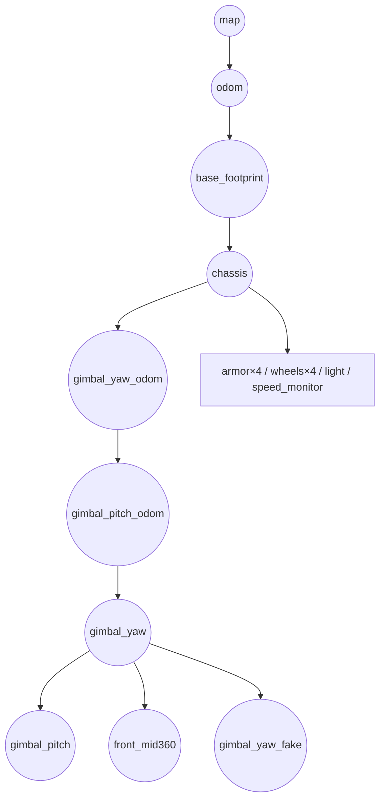
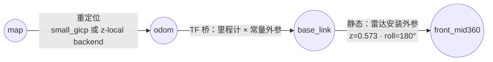
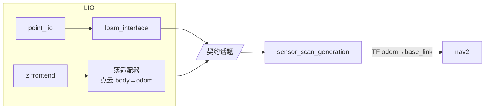

# NavX TF 精简方案（map → odom → base_link）

> 目标：把现有 4 段动态 + 23 link 的 TF 树，压到 **3 条边、1 条静态**；保留 `livox → 定位 → nav2 → serial` 主链路，两套定位后端（`point_lio + small_gicp` / `z-localization`）可切换。
> 约束（你已确认）：`base_link` = **云台 yaw 轴在地面的投影**；云台 yaw 会相对底盘独立转动，底盘与云台都会旋转；导航时仍需要自旋扫描；**不改 point_lio 等核心源码**；允许新增一个小 TF 桥节点并删除无用包。

---

## 0. 结论先说

现方案的复杂度来自两件事：

1. **point_lio 的原点在倾斜雷达上**，而 Nav2 要地面基座 → 于是有了 `camera_init → odom`（loam_interface）和 `odom → base_footprint`（sensor_scan_generation）两层换算。
2. **Nav2 的基座不能跟着云台/底盘转** → 于是有了 `gimbal_yaw → gimbal_yaw_fake`（fake_vel_transform）再加一层。

把 `base_link` 定义成"**云台 yaw 轴的地面投影**"之后，第 2 个问题自动消失：

- 雷达刚性装在云台上 ⇒ **雷达的姿态 = 云台的姿态**，而 `base_link` 的 yaw 也跟随云台 ⇒ `base_link → 雷达` 是一条**永远成立的静态外参**，不需要云台关节角，也不需要 `joint_states`。
- 云台相对底盘的转动，已经被"雷达跟着云台转"这件事吸收了 ⇒ 定位算出来的 `odom → 雷达` 就是 `odom → base_link` 加一个常量。
- 下位机要的正好是云台系 ⇒ `cmd_vel` **不需要任何坐标换算**，`fake_vel_transform` 的速度旋转也一起删掉。

所以新树只有：

```
map ──(重定位)──> odom ──(里程计 + 一个常量外参)──> base_link ──(静态安装外参)──> front_mid360
```

---

## 1. 改造前后对比

### 现状



### 目标



**无 `chassis`、无 `gimbal_*`、无 `base_footprint`、无 `*_fake`、无 URDF。**

---

## 2. 帧定义与唯一外参

| frame | 定义 | 谁发布 | 频率 |
|---|---|---|---|
| `map` | 先验地图世界系 | 名义帧：`map_server` 只提供地图数据，**没有节点发 `map` 的 TF**（它是树的根） | 静态地图 |
| `odom` | 连续里程计系（无跳变） | 重定位节点（`small_gicp` 或 z-local backend） | 20 Hz / 随帧 |
| `base_link` | **云台 yaw 轴在地面的投影**：原点在 z=0，yaw = 云台 yaw | TF 桥节点（新增） | 随里程计 ≈10 Hz |
| `front_mid360` | 雷达坐标系（Livox 驱动 `frame_id`） | 静态 TF | `/tf_static` |

### 唯一的静态外参（`base_link → front_mid360`）

| 项 | 值 | 推导 |
|---|---|---|
| x | **-0.038** | `front_livox_joint` 的 x |
| y | **0.0** | — |
| z | **0.573** | `chassis_height 0.140` + 雷达安装高 `0.433` |
| roll | **π（3.14159265）** | 雷达倒装 |
| pitch / yaw | 0 / 0 | — |

> 这组数不是新拍的：项目里 `src/tool/pcd2pgm/config/pcd2pgm.yaml:4` 用的 `odom_to_lidar_odom: [-0.038, 0.0, 0.573, 3.14, 0.0, 0.0]` 就是同一组地面→雷达外参，可直接复用；同文件 `:5` 被注释掉的 `[-0.16, 0.0, -0.18, -0.523599, 0.0, -1.5707963]` 正是仿真机型的挂点——两套挂点在这份配置里已经并存，选实车那组即可。

启动命令只需一条：

```bash
ros2 run tf2_ros static_transform_publisher \
  --x -0.038 --y 0.0 --z 0.573 \
  --roll 3.14159265 --pitch 0.0 --yaw 0.0 \
  --frame-id base_link --child-frame-id front_mid360
```

---

## 3. 为什么不需要云台关节角（关键论证）

| 问题 | 现状做法 | 新方案 |
|---|---|---|
| 云台转，雷达跟着转，`base_link` 跟不跟？ | `base_link` 原本是底盘，`gimbal_yaw` 用 URDF + `/joint_states` 算 | **跟**。`base_link` 定义就跟随云台 yaw |
| 那 `base_link → 雷达` 会不会变？ | 会（云台在动） | **不会**：雷达与云台刚性固连，两者一起转，相对变换恒定 |
| 云台角从哪来？ | `serial/gimbal_joint_state`（**实际无发布者**，一直是 0） | **不需要**。云台转动直接体现为里程计的旋转 |
| 底盘姿态从哪来？ | URDF 链 | **不需要**。底盘不参与导航 TF；下位机自己知道底盘角 |

代价：**TF 里再也看不到底盘/云台/装甲/轮子的位姿**。这正好符合"下位机参考云台系"的约定——导航只关心云台系的位姿，底盘姿态由下位机闭环。

---

## 4. 两套定位后端：统一接口

TF 桥节点只认一个契约，两个后端都必须满足：

**后端契约（Backend Contract）**

| # | 提供物 | 要求 |
|---|---|---|
| 1 | `map → odom` TF | 唯一一条外部 TF；**不得**再发 `odom → 车体` 的 TF |
| 2 | 里程计话题 | `nav_msgs/Odometry`，pose = `odom → source_frame`（source = `front_mid360` 或 `imu`） |
| 3 | 点云（可选） | 供 `terrain_analysis` 使用；可在 source 系或 odom 系 |

### 4.1 路径 A：point_lio + small_gicp（保留现状最小改动）

| 步骤 | 节点 | 说明 |
|---|---|---|
| 1 | `livox_ros_driver2` | `/livox/lidar`(CustomMsg) + `/livox/imu`，`frame_id: front_mid360` |
| 2 | `point_lio` | `tf_send_en: False`（已经是）；输出 `aft_mapped_to_init`、`cloud_registered` |
| 3 | `loam_interface` | 把 `lidar_odom → odom`，输出 `lidar_odometry`（**child = front_mid360**）与 `registered_scan`（odom 系） |
| 4 | `small_gicp_relocalization` | 输出 `map → odom`；`base_frame: base_link`、`lidar_frame: front_mid360` |
| 5 | **TF 桥（新增）** | 订阅 `lidar_odometry` + 外参 `base_link→front_mid360` → 发 `odom → base_link` 与 `/odom` |

TF 桥输入外参 = `base_link → front_mid360`，与静态 TF 同一组数（`-0.038, 0, 0.573, π, 0, 0`），内部求逆即可。

### 4.2 路径 B：z-localization

| 步骤 | 节点 | 说明 |
|---|---|---|
| 1 | `livox_ros_driver2`（z 版） | 输出 Livox CustomMsg（`frame_id` 需与其它一致） |
| 2 | `frontend`（ZLIO） | **必须关掉自带 TF**：`publish_tf: false`；输出 `/odometry`（pose = `odom → imu`） |
| 3 | `backend` | `common/map_frame: map`、`common/odom_frame: odom`；输出 `map → odom` |
| 4 | **TF 桥（新增）** | 订阅 `/odometry` + 外参 `base_link→imu` → 发 `odom → base_link` 与 `/odom` |
| 5 | 点云 | `/frontend/frame` 的点云在 **body(imu) 系**，需 TF 桥顺带转到 odom 后输出 |

`base_link → imu` 外参（由 `base_link→lidar` 与 z 的 `body_from_lidar` 复合得到，**需实测复核**）：

| x | y | z | roll | pitch | yaw |
|---|---|---|---|---|---|
| -0.0270 | -0.02329 | 0.61712 | π | 0 | 0 |

> 推导：`T_base_body = T_base_lidar · inverse(T_body_lidar)`，其中 `T_body_lidar` 取 `config/lio.yaml` 的 `body_from_lidar`（t=(-0.011, -0.02329, 0.04412), r=I）。

### 4.3 切换方式

```bash
# 路径 A
ros2 launch pb2025_nav_bringup rm_navigation_reality_launch.py localization:=lio
# 路径 B
ros2 launch pb2025_nav_bringup rm_navigation_reality_launch.py localization:=zlocal
```

`localization` 作为顶层 launch 参数，只切换 `localization_launch.py` 的分支与 TF 桥的外参/profile，nav2/serial 完全不动。

---

### 4.4 统一适配层：契约 + 每套 LIO 一个薄适配器

想让 `sensor_scan_generation` 一套吃下所有 LIO，前提是把输入统一成一个**契约**。它只做最后一步（source → base_link），**不负责**把各家私有帧名 / 私有约定翻译过来。



**契约（两套 LIO 都必须满足）**

| 项 | 要求 |
|---|---|
| 话题 | `/lidar_odometry`（Odometry）+ `/registered_scan`（PointCloud2） |
| 里程计 | `header.frame_id = odom`，`child_frame_id = source`（`front_mid360` 或 `imu`），pose = `T_odom_source` |
| 点云 | 坐标必须在 **odom 系**（`terrain_analysis` 不看 `frame_id`，只看数值） |
| TF | 不发 `odom→source`；重定位只发 `map→odom` |

| LIO | 谁产出契约 | 现状 |
|---|---|---|
| `point_lio` | **`loam_interface`**：`camera_init→odom` 改名 + 重锚定 + 点云换系 | **已满足，零改动** |
| `z_location` | frontend 的 `/odometry`（`odom→imu`）已合规；**点云在 body 系**（`ros.cpp:93`），需一个 ~30 行转换 | 差最后一步 |

> **结论**：`sensor_scan_generation` 可以当统一层，但**替代不了 `loam_interface`**——后者是 point_lio 的"翻译器"。
> 强行去掉 loam_interface，就得让 `camera_init` / `body` 两个私有帧名进入 TF 树（再加 `odom→camera_init` 静态别名），与"只留 3 个 frame"的目标冲突，省不到什么。
> 只有当你彻底不用 point_lio 之后，`loam_interface` 才可以删。

## 5. `odom → base_link` 由谁发

### 5.1 为什么 LIO 不能直接发

| 后端 | 能否自己发 `odom→base_link` | 原因 |
|---|---|---|
| `point_lio` | **不能** | 帧名 `camera_init`/`body`/`aft_mapped` 硬编码在 `laserMapping.cpp`；`tf_send_en` 只开关 `camera_init→aft_mapped`，且发的是 **IMU(body) 位姿**，不是地面投影的 base_link。要它发就必须改源码（你说不动核心）。 |
| `z_location` | **能，但语义不对** | `world_frame`/`body_frame`/`publish_tf` 都是参数，确实可以 `body_frame:=base_link` 直接发 `odom→base_link`。但它的 body 是 **IMU**，这样 `base_link` 原点会落在雷达高度（z≈0.573 m）。`terrain_analysis` 拿 `odometry` 的 z 当高度基准（`terrainAnalysis.cpp:122`），基准抬高 ≈0.43 m，`minRelZ/maxRelZ` 全要重调，避障会变。 |

结论：两套 LIO 都只能给出 **body/IMU** 位姿；`base_link` 要落在地面，就**必须有一次刚体外参复合**。这不是"新功能"，是坐标定义问题。

### 5.2 三种做法（推荐 A / B，都不新增包）

| 方案 | 做法 | 新增代码 | 代价 |
|---|---|---|---|
| **A（路径 A 用）** | 复用 `sensor_scan_generation`，`base_frame` / `robot_base_frame` 都改成 `base_link` | **0 行** | 无 |
| **B（路径 B / z 用）** | 让 z 的 frontend 自己发 `odom→imu`（`publish_tf: true`、`body_frame: imu`），再补一条静态 `imu→base_link` | **0 行** | TF 里多一个 `imu` 帧 |
| C（可选） | 写 `odom_to_base_link` 适配节点 | ~160 行 | 统一两套后端、去掉 `sensor_scan` 旁支 |

方案 B 的静态外参（`T_base_imu` 的逆，已用 numpy 复核）：

```
imu → base_link : x=0.027  y=-0.02329  z=0.61712  roll=π  pitch=0  yaw=0
```

> 方案 B 下 `odom→base_link` 由 `odom→imu→base_link` 合成，仍是三段链，只是多了一个 `imu` 名字。若你坚持树上只能有 3 个 frame，就用 C。

### 5.3 方案 A 的具体改法（零代码）

`sensor_scan_generation` 的本质就是"把雷达位姿换算成车体位姿"，三个 frame 全是参数：

```yaml
sensor_scan_generation:
  ros__parameters:
    lidar_frame: "front_mid360"
    base_frame: "base_link"          # 原 base_footprint
    robot_base_frame: "base_link"    # 原 gimbal_yaw
```

改完它就会：发唯一一条 TF `odom→base_link`；发 `/odometry`（child=`base_link`）；`sensor_scan` 无消费者可忽略。

### 5.4 方案 C 的节点规格（仅在需要时）

新包 `navx_localization_adapter`（C++，约 160 行，结构照搬 `sensor_scan_generation.cpp`，去掉多余逻辑）。

| 项 | 内容 |
|---|---|
| 可执行 | `odom_to_base_link_node` |
| 订阅 | `odom_topic`（`nav_msgs/Odometry`）；可选 `cloud_in`（`PointCloud2`） |
| 发布 | `/tf`（`odom → base_frame`）；`/odom`（child = `base_frame`）；可选 `cloud_out`（odom 系） |
| 参数 | `odom_topic`、`odom_frame`、`base_frame`、`source_frame`、`base_to_source`（6 元组，安装外参）、`publish_tf`、`transform_cloud`、`cloud_in`、`cloud_out` |
| 计算 | `T_odom_base = T_odom_source · inverse(T_base_source)`；twist 用 `R_base_source` 旋转后再发；点云用 `T_odom_source` 变换 |
| 频率 | 跟消息（≈10 Hz），不额外起定时器 |

**只在以下情况才值得写 C**：① 要同时接两套定位且希望 `base_link` 严格在地面、树上不出现 `imu`；② 想顺手去掉 `sensor_scan` 与 twist 差分。

## 6. 包去留清单

### 6.1 删除（导航链路不再需要）

| 包 | 删除理由 | 连带要改 |
|---|---|---|
| `st_opt` | yaml 整段注释，未启用 | — |
| `pb2025_robot_description` | 实车不再需要 URDF；静态 TF 一条替代整棵 FK 树 | reality launch 的 `robot_state_publisher_launch` |
| `sdformat_tools` | 只被 `pb2025_robot_description` 用 | — |
| `rmoss_gz_resources` | 同上（几十 MB mesh） | — |
| `joint_state_publisher` / `joint_state_publisher_gui` | 只服务 URDF FK | — |
| `ign_sim_pointcloud_tool` | 只有 Gazebo 仿真用 | 若保留仿真则保留 |

> **`pb_teleop_twist_joy_node`**：yaml 里有配置但 `joy_teleop_launch.py` 从未被 reality launch 引用，可一并删除（否则它的 `robot_base_frame: gimbal_yaw` 会误导）。

### 6.2 保留

| 包 | 用途 | 需要的改动 |
|---|---|---|
| `livox_ros_driver2` | 雷达驱动 | **两份副本去重**（z-localization 里那份加 `COLCON_IGNORE`） |
| `point_lio` | 里程计 | 仅改 yaml（`tf_send_en` 已 False） |
| `loam_interface` | **point_lio 的契约适配器**（改名+重锚定+点云换系，§4.4） | yaml 帧名改 `base_link`；**保留** |
| `sensor_scan_generation` | **零代码 TF 桥**（§5.3）：发 `odom→base_link` 与 `/odometry` | 仅改 yaml：`base_frame`/`robot_base_frame` = `base_link`；`sensor_scan` 无消费者可忽略 |
| `small_gicp_relocalization` | 路径 A 的 `map→odom` | yaml `base_frame: base_link` |
| `terrain_analysis` / `terrain_analysis_ext` | 地形 → costmap | 无需改（输出 odom） |
| `pointcloud_to_laserscan` | 建图用 | `target_frame: base_link` |
| `pcd2pgm` | 离线 PCD→栅格 | — |
| `pb2025_nav_bringup` | 启动 | launch + yaml 大改（见 §7） |
| `pb_nav2_plugins` | `IntensityVoxelLayer`（在用） | 仅保留 costmap 层，可删掉 unused behavior |
| `behavior_ext_plugins` | `BackUpTwzFree`（实车 backup） | — |
| `serial` | 串口 + 决策 | 自旋注入迁入（见 §8） |
| `pb2025_sentry_nav` | metapackage | 可留可删 |

### 6.3 新增

| 项 | 说明 |
|---|---|
| `navx_localization_adapter`（仅方案 C，默认不建） | TF 桥（§5.4）。**路径 A/B 都用零代码方案，不需要此包** |
| `localization` 参数（`lio` / `zlocal`） | 后端切换 |

---

### 6.4 保留但不用（按你的要求）

| 包 | 处置 |
|---|---|
| `fake_vel_transform` | **保留源码**，只从 launch 与 `nav2_params.yaml` 里移除（不再发 `gimbal_yaw_fake`） |
| `traversability_layer` | 保留，不配置、不接入 costmap |
| `goal_approach_controller` | 保留，`FollowPath` 继续用 MPPI |
| `rm_interfaces` | 保留，当前无引用 |

> 这 4 个包不参与编译产物之外的任何改动；删除它们留到以后单独提交。

## 7. 启动与参数改动

### 7.1 `rm_navigation_reality_launch.py`

```diff
- start_robot_state_publisher_cmd   # 整块删除（use_robot_state_pub 参数一并删）
  start_livox_ros_driver2_node
+ start_static_tf_base_link_to_lidar   # static_transform_publisher（§2）
  bringup_cmd
  rviz_cmd
```

> **注意**：`nav.bash`、`map.sh`、`map_nav.bash` 都显式传了 `use_robot_state_pub:=True`。删参数后这些脚本要同步删掉该实参；若不想动脚本，就保留参数声明但让它**空操作**（声明了不用），否则 `ros2 launch` 可能报未声明参数。

### 7.2 `localization_launch.py`

```diff
  point_lio                         # 路径 A 保留；路径 B 用 frontend
  map_server
  small_gicp_relocalization         # 仅路径 A
+ # 路径 A：sensor_scan_generation 改两个 frame 参数即可（§5.3，零代码）
+ # 路径 B：z frontend 发 odom→imu + 静态 imu→base_link（§5.2 方案 B，零代码）
```

### 7.3 `navigation_launch.py`

```diff
  sensor_scan_generation            # 保留：base_frame/robot_base_frame 改 base_link（§5.3）
- fake_vel_transform               # 删
  loam_interface                   # 路径 A 保留
  terrain_analysis(_ext)
  controller/planner/behavior/bt/waypoint/velocity_smoother
```

### 7.4 `nav2_params.yaml` 关键改动

| 配置项 | 现值 | 新值 |
|---|---|---|
| `bt_navigator.robot_base_frame` | `gimbal_yaw_fake` | `base_link` |
| `bt_navigator.odom_topic` | `odometry` | `odom` |
| `controller_server.odom_topic` | `odometry` | `odom` |
| `local_costmap.robot_base_frame` | `gimbal_yaw_fake` | `base_link` |
| `global_costmap.robot_base_frame` | `gimbal_yaw_fake` | `base_link` |
| `smoother_server.robot_base_frame` | `gimbal_yaw_fake` | `base_link` |
| `behavior_server.robot_base_frame` | `gimbal_yaw_fake` | `base_link` |
| `velocity_smoother.odom_topic` | `odometry` | `odom` |
| `loam_interface.base_frame` | `base_footprint` | `base_link` |
| `small_gicp.base_frame` | `base_footprint` | `base_link` |
| `small_gicp.robot_base_frame` | `gimbal_yaw` | `base_link` |
| `pointcloud_to_laserscan.target_frame` | `base_footprint` | `base_link` |
| `slam_toolbox.base_frame` | `base_footprint` | `base_link` |
| `costmap.observation_sources.*.sensor_frame` | `front_mid360` | 不变（靠静态 TF） |
| `fake_vel_transform.*` | 存在 | **整段删除** |
| `sensor_scan_generation.*` | `base_frame: base_footprint`、`robot_base_frame: gimbal_yaw` | 两处都改 `base_link`（**整段保留**） |

### 7.5 `cmd_vel` 通路收敛

现状：`controller → cmd_vel_controller → velocity_smoother → cmd_vel_nav2_result → fake_vel_transform → cmd_vel`

新：`controller → cmd_vel_controller → velocity_smoother → cmd_vel → serial`

```diff
- ("cmd_vel_smoothed", "cmd_vel_nav2_result")
+ ("cmd_vel_smoothed", "cmd_vel")
```

`behavior_server` 的 `cmd_vel` 也直接指向 `cmd_vel`（恢复行为要能驱动底盘）。

---

## 8. 串口 / 下位机

- **`cmd_vel` 语义**：现在直接就是**云台系**速度（`base_link` = 云台 yaw 地面投影），serial 原来的"速度已由 fake_vel_transform 转好"的假设变得简单——**零换算**。
- **`robot_yaw`**：`/odom`（child = `base_link`）的 yaw，即云台系在世界中的朝向，继续发给下位机。
- **自旋**：把 `fake_vel_transform` 里那 3 行搬进 serial：

```cpp
// serial 收到 cmd_vel 后、打包前
wz_send = wz + spin_speed_;    // spin_speed_ 来自 cmd_spin (example_interfaces/Float32)
```

  serial 增加一个 `cmd_spin` 订阅（约 10 行），默认 0 即无自旋。**不产生任何 TF**。

---

## 9. 自旋扫描怎么处理（必须选一种物理模式）

`base_link` 跟随云台，所以"自旋"到底转谁，决定 Nav2 会不会看到旋转：

| 模式 | 物理行为 | `odom→base_link` | Nav2 影响 | 适合 |
|---|---|---|---|---|
| **A. 云台保持指向、底盘自旋**（推荐） | 底盘转，云台反向补偿，雷达/`base_link` 朝向不变 | **不转** | 无感，MPPI 正常 | 哨兵常规扫描 |
| B. 云台与底盘刚性同转 | 整机转，雷达跟着转 | **跟着转** | Nav2 会看到基座持续旋转，MPPI 需要重调，甚至退化回"伪基座"方案 | 不建议 |

- 选 **A**：本方案完全成立，`fake_vel_transform` 可以干净删除，自旋由下位机/云台控制器执行（serial 只负责把 `wz` 加个偏置）。
- 选 **B**：`base_link` 会持续旋转，等于把问题从 TF 挪到了里程计。这时要么接受 Nav2 在旋转基座下工作（需重调 `MPPI` 的 `vx/vy/wz` 权重与 `transform_tolerance`），要么保留一个"伪基座"概念——与本方案目标冲突。

> **待确认**：实际自旋时云台是"保持指向"还是"跟着底盘一起转"？这决定 §9 选 A 还是 B。

---

## 10. 分阶段迁移（每阶段可独立回滚）

| 阶段 | 内容 | 验收 |
|---|---|---|
| **P0 清理** | `rm -rf build install log`；z-localization 的 `livox_ros_driver2` 加 `COLCON_IGNORE`；删 §6.1 的包 | `colcon build` 通过；`ros2 pkg list` 无幽灵包 |
| **P2 去 URDF** | 从 reality launch 移除 `robot_state_publisher_launch` | costmap/导航正常；RViz 用 Marker 替代机器人模型 |
| **P3 串口** | `cmd_vel` 直连；自旋注入迁入 serial（先置 0 跑通） | 手动 `ros2 topic pub /cmd_vel` 底盘按云台系响应 |
| **P4 z_location** | 加 `localization:=zlocal` 分支 + TF 桥 profile；`publish_tf: false` | 同一套 nav2 参数下两后端都能导航 |
| **P5 回归** | 建图 / 重定位 / 自旋 / 急停 | 见 §11 |

**回滚点**：P1 之前打 tag；P1 改的是 launch/yaml，可 `git checkout` 单文件回退；P4 用 launch 参数切换，不需要回滚代码。

---

## 11. 验证清单

```bash
# 1) TF 树只应有三条边（map→odom、odom→base_link、base_link→front_mid360）
ros2 run tf2_tools view_frames
ros2 run tf2_ros tf2_echo map base_link
ros2 run tf2_ros tf2_echo odom base_link
ros2 run tf2_ros tf2_echo base_link front_mid360     # 必须是静态、数值恒定

# 2) 频率与一致性
ros2 topic hz /odom                                  # ≈10 Hz
ros2 topic echo /odom --once                         # child_frame_id = base_link
ros2 run tf2_ros tf2_monitor map base_link           # 延迟/抖动

# 3) 导航
ros2 action send_goal /navigate_to_pose nav2_msgs/action/NavigateToPose \
  "{pose: {header: {frame_id: map}, pose: {position: {x: 1.0, y: 0.7}}}}"

# 4) 静态外参校验：让机器人对准一面墙，确认 costmap 里墙的朝向与距离正确
ros2 topic echo /terrain_map --field header

# 5) 自旋（模式 A 下 base_link 的 yaw 不应变化）
ros2 topic pub /cmd_spin example_interfaces/msg/Float32 "{data: 3.14}" -1
ros2 run tf2_ros tf2_echo odom base_link
```

---

## 12. 风险与待确认

### 12.1 风险

| # | 风险 | 影响 | 缓解 |
|---|---|---|---|
| 1 | **删掉 URDF 后 RViz 无机器人模型** | 调试观感差（RobotModel 依赖 TF） | 用 Marker 画一个车体框；或保留一个"仅可视化"的 rsp（会多发 TF，不建议） |
| 2 | `base_link` 在 z=0 但 Nav2 footprint 默认按 base_link | 2D costmap 不关心 z，但 `pointcloud_to_laserscan` 的 `min_height` 等参数可能需微调 | 建图时校验一次 |
| 3 | 模式 B（整机同转）时 `base_link` 跟着转 | MPPI 抖动、局部路径漂移 | 先确认 §9 的物理模式 |
| 4 | z_location 点云在 body 系 | `terrain_analysis` 会当成 odom 系点用，导致障碍物错位 | TF 桥开 `transform_cloud: true` |
| 5 | `map→odom` 用未来 0.1 s 时间戳 | 跨 TF 查询偶发 extrapolation | 保留 0.1 s `transform_tolerance`，或改回当前时间 |
| 6 | 删 `rmoss_gz_resources`/`pb2025_robot_description` 后无法跑 Gazebo | 仿真链路断 | 若还要仿真，把这两个包与 sim launch 单独保留 |
| 7 | `small_gicp` 启动时要查 `base_link↔front_mid360` | 静态 TF 未起来时地图摆错（代码里会死等） | 保证 static TF 先于 small_gicp 启动（launch 顺序/Timer） |

### 12.2 待确认

1. **自旋时云台是"保持指向"还是"整机同转"？**（决定 §9 选 A/B，是本方案成立与否的关键）
2. **还需要 Gazebo 仿真吗？**（决定 `pb2025_robot_description`/`rmoss_gz_resources`/`ign_sim_pointcloud_tool` 是删还是留）
3. **雷达 frame 名要不要顺便从 `front_mid360` 改成 `lidar`？**（改则要同步驱动 yaml、静态 TF、costmap `sensor_frame`、small_gicp `lidar_frame`）
4. **下位机的"云台系"是否就是 yaw=0 时车头朝前？** 若是，`cmd_vel` 直连即可；若下位机期望的是"底盘系 + 单独云台角"，则 `cmd_vel` 还要按云台-底盘夹角旋转一次（那就要么让下位机做，要么在 serial 里用云台角补偿）。
5. **`base_link` 的 z 取 0（地面）还是 0.14（云台安装高）？** 已按你选的"地面投影"设计；若下游有按高度取点的逻辑需同步。

---

## 13. 一页速查：改完之后的启动链

```
livox_ros_driver2  ──/livox/lidar(CustomMsg), /livox/imu──┐
                                                          ▼
point_lio ──aft_mapped_to_init, cloud_registered──► loam_interface
                                                          │ /lidar_odometry (odom→front_mid360)
                                                          │ /registered_scan   (odom)
                                                          ▼
small_gicp_relocalization ──TF map→odom──┐     sensor_scan_generation
                                          │        │ TF odom→base_link
                                          │        │ /odom (child=base_link)
                                          ▼        ▼
                            terrain_analysis(_ext) ──/terrain_map(_ext)──► nav2 costmaps
                                                                              │
                                          static TF base_link→front_mid360    │
                                                                              ▼
                                                       nav2 (map/odom/base_link)
                                                                              │ /cmd_vel（云台系）
                                                                              ▼
                                                                    serial（+cmd_spin）──► 下位机
```


---

## 14. 提交计划（Git）

**分支约束**：只在当前分支 `rmuc2026_dev` 上提交；不切分支、不碰 `main` / `rmuc2026` / `2d_dev`、不 push。

**规则**：一个功能改动 = 一个 commit；删除一个包 = 一个 commit；不把无关文件混入（`*.pyc`、`.dsh/`、根目录 webp 都不提交）。

| # | commit message | 内容 | 类型 |
|---|---|---|---|
| C1 | `docs: 新增 ROS2 包与 TF 分析、TF 精简方案` | `docs_ros2_packages_and_tf.md`、`docs/tf_simplification_plan.md` | 文档 |
| C2 | `refactor(tf): 导航链路收敛为 map→odom→base_link` | launch + `nav2_params.yaml` + 静态外参 + `sensor_scan_generation` 参数 + 移除 fake/rsp 节点 | 功能 |
| C3 | `feat(serial): cmd_vel 直连与自旋注入` | serial 订阅 `cmd_spin`、速度直发 | 功能 |
| C4 | `feat(bringup): 增加 localization 后端切换参数` | `localization:=lio/zlocal` | 功能 |
| C5 | `delete(pkg): 删除 ign_sim_pointcloud_tool` | 仿真不用时 | 删除 |
| C6 | `delete(pkg): 删除 rmoss_gz_resources` | 模型资源 | 删除 |
| C7 | `delete(pkg): 删除 sdformat_tools` | SDF→URDF 工具 | 删除 |
| C8 | `delete(pkg): 删除 joint_state_publisher` | URDF FK 用 | 删除 |
| C9 | `delete(pkg): 删除 joint_state_publisher_gui` | 同上 | 删除 |
| C10 | `delete(pkg): 删除 pb2025_robot_description` | 模型包 | 删除 |

**提交前检查**：`git status` 确认只含预期路径；`git add <具体文件>`，不用 `git add -A`；每个 commit 独立可编译（C5~C10 都是删无用包，删完跑一次 `colcon build`）。

**当前工作区已知脏文件**：6 个 `*.pyc` 是历史提交过的产物，改动与本次无关，**不要提交**（建议后续单独加 `.gitignore` 并 `git rm --cached`）。

---

## 15. point_lio 单路线执行清单（先不做 z）

**范围**：只精简 `point_lio + small_gicp` 路线；`src/location/z-localization` 原样保留不接入。

### C1：纯文档

```bash
git add docs_ros2_packages_and_tf.md docs/tf_simplification_plan.md
git commit -m "docs: 新增 ROS2 包与 TF 分析、TF 精简方案"
```

### C2：一个功能改动（基座 + 速度参考系统一）

**1）`config/reality/nav2_params.yaml`**

| 位置 | 改动 |
|---|---|
| `fake_vel_transform:` | **整段删除** |
| `sensor_scan_generation.base_frame` / `.robot_base_frame` | → `base_link` |
| `loam_interface.base_frame` | → `base_link` |
| `small_gicp_relocalization.base_frame` / `.robot_base_frame` | → `base_link` |
| `bt_navigator.robot_base_frame` | → `base_link` |
| `local_costmap.robot_base_frame` / `global_costmap.robot_base_frame` | → `base_link` |
| `smoother_server.robot_base_frame` / `behavior_server.robot_base_frame` | → `base_link` |
| 建图：`pointcloud_to_laserscan.target_frame`、`slam_toolbox.base_frame` | → `base_link` |
| 所有 `odom_topic` | **保持 `odometry` 不变**（`sensor_scan_generation` 发布的还是这个名字） |

**2）`launch/rm_navigation_reality_launch.py`**

- 删掉 `robot_state_publisher_launch.py` 的 Include（`use_robot_state_pub` 参数保留声明但不再使用，`nav.bash` / `map.sh` 不用改）
- 新增静态外参节点：

```python
Node(
    package="tf2_ros", executable="static_transform_publisher",
    name="static_tf_base_link_to_lidar", output="screen",
    arguments=["--x", "-0.038", "--y", "0", "--z", "0.573",
               "--roll", "3.14159265", "--pitch", "0", "--yaw", "0",
               "--frame-id", "base_link", "--child-frame-id", "front_mid360"],
)
```

**3）`launch/navigation_launch.py`**

- 删除 `fake_vel_transform` 的 `Node`（非组合分支）与 `ComposableNode`（组合分支）
- `velocity_smoother` 输出改 `("cmd_vel_smoothed", "cmd_vel")`
- `behavior_server` 的 `("cmd_vel", "cmd_vel_nav2_result")` 改为 `("cmd_vel", "cmd_vel")`

**验收**：`view_frames` 只剩 `map→odom→base_link→front_mid360`；`/odometry` 的 `child_frame_id=base_link`；能正常导航到点。

> ⚠️ C2 之后**自旋会失效**（`spin_speed` 原本加在 fake 里），C3 恢复。另外 `base_link` 由 z=0.14 变为 z=0，`terrain_analysis` 的高度基准整体下移 0.14 m，首次上车要复核低矮障碍检测（必要时把 `minRelZ` 回调）。

### C3：一个功能改动（自旋迁移）

- `src/io/serial_driver/src/ros2/serial_node.cc`：新增 `cmd_spin`（`example_interfaces/Float32`）订阅，打包前 `wz_send = wz + spin_speed_`
- 验收：`ros2 topic pub /cmd_spin ... 3.14`，底盘转、`odom→base_link` 的 yaw 不变（云台保持指向时）

### C4+：每删一个包一个提交

| 顺序 | commit |
|---|---|
| C4 | `delete(pkg): 删除 ign_sim_pointcloud_tool`（不做仿真时） |
| C5 | `delete(pkg): 删除 rmoss_gz_resources` |
| C6 | `delete(pkg): 删除 sdformat_tools` |
| C7 | `delete(pkg): 删除 joint_state_publisher` |
| C8 | `delete(pkg): 删除 joint_state_publisher_gui` |
| C9 | `delete(pkg): 删除 pb2025_robot_description` |

> 若还要 Gazebo 仿真，C4–C9 全部暂缓（这几个包是仿真模型链）。
