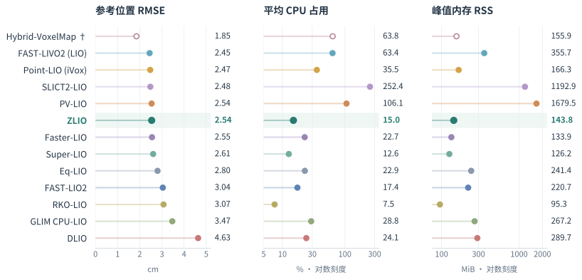
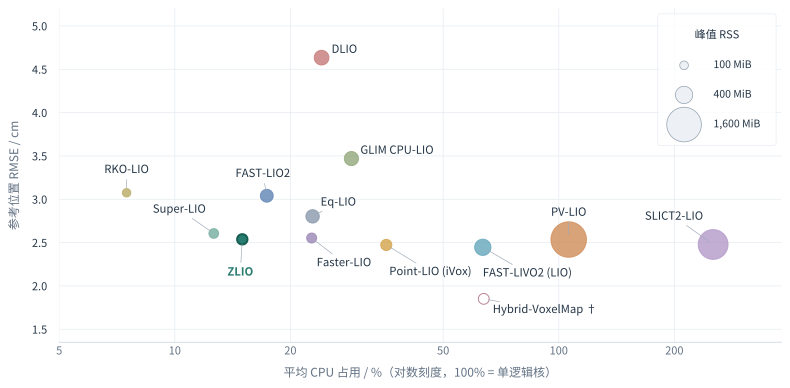
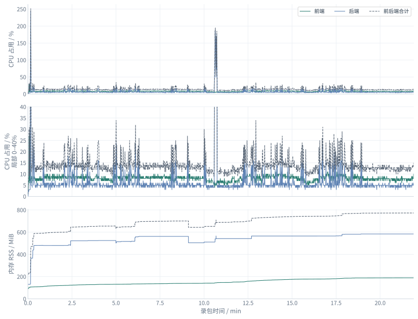
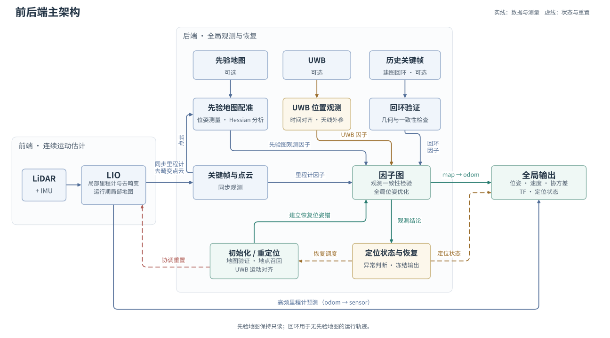
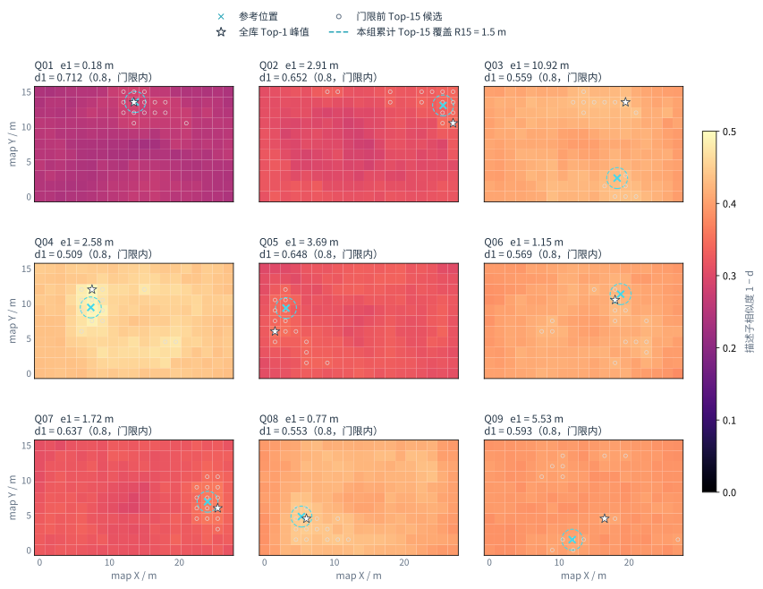

# Z-Localization 设计说明

[返回项目首页](../README.md) · [前言](#前言) · [第一章：前后端主架构](#第一章前后端主架构) · [第二章：前端里程计设计](#第二章前端里程计设计) · [第三章：后端定位设计](#第三章后端定位设计) · [后记](#后记)

## 前言

从青工会我提到要开源已经过于近两个月了，因为个人在准备推免（和摆烂），现在才开出来，非常抱歉。
正如我在青工会所说，SLAM 的领域非常广泛，我更希望向大家分享我的思路，做到抛砖引玉。
比赛过后我有更多的时间整理代码和消融方案，所以部分实现会和青工会的分享略有不同，请大家以本文章与仓库为准。
整个系统尤其是对于前端来讲，我们都没有做到对比学术的上限有显著的优势（当然跟主流方法来比也没有显著劣势），
更多的设计来自于我觉得应该如此设计，如有错误请大家多多包容，期待与大家沟通共同进步。

如果你更偏向于单一 LIO 系统，我们的前端可以单独使用，如果你更喜欢自己的前端或者奥丁之眼定位模块，
也可以配合我们的后端使用。当然，我们也提供了一站式建图到定位的完整流程，建议参考仓库教程。

*IndoorOffice1 上 13 种前端方法或模式的对比，各项指标取三次运行的中位数。*

IndoorOffice1 是一组使用 Mid-360 采集的室内数据。从这组对比可以看到，我们的前端在精度、CPU 和内存占用上都表现不错，但也没有在所有指标上胜出。

*使用真实赛场数据集。开启先验地图和 UWB 时，前后端的 CPU 与内存占用。*

后端主要做工程处理，目前没有合适的手段单独测试精度，因此这里只展示开销。
正常定位时，后端的计算开销很小，和前端一起运行，裸负载下的 CPU 占用约为 15%（100% 对应一个逻辑核）。
启动和异常恢复时，则会以较大的开销计算，尽快找回位置。
后端的内存占用相对较高，一定程度上是用空间换时间。我们的运算设备内存比较富裕，这部分没有成为限制。
如果设备无法接受这样的内存开销，可以通过调整后端参数降低占用。

开源仓库：https://github.com/mozihe/z-localization.git

Email：zhujunheng2005@gmail.com

QQ：820288431

## 第一章：前后端主架构

### 1.1 整体组织

*图 1：前后端的主要架构。*

前端负责估计 odom 系中的运动。它结合 LiDAR 和 IMU 更新局部里程计，自己维护运行时的局部地图，
并把去畸变点云与同一时刻的里程计打包送给后端。同时，前端还会根据 IMU 进行高频传播，持续提供实时位姿。

后端负责维护 map → odom 的变换，它从前端送来的观测中选取关键帧，将这些帧的全局位姿放入因子图中优化。
前端提供相邻关键帧之间的相对运动；先验地图配准提供当前扫描在地图中的位姿及其约束强度；
UWB 提供额外的位置测量。无先验地图时，还可以进行回环检测，引入回环约束。

初始化和恢复时，前端先在当前位置建立自己的 odom 系，后端再结合地图、描述子和 UWB 信息，
找到对应的全局位姿，确定新的 TF。定位成功后，后端将这个位姿作为图中的锚点，恢复正常输出。

### 1.2 设计思路

我们去年的做法是直接给 LIO 加载一张先验图，然后直接启动。
LIO 本身是紧耦合的，发散不太好判断。有时候位置飞了，或者速度、加速度已经比较离谱了，才能发现里程计爆炸了。

所以我们把 LIO 和先验图定位拆开：LIO 维护自己的里程计，先验图配准则作为测量关系加入因子图。
分开之后，可以直接对先验图配准的海森矩阵做可观测性分析，再结合配准结果，判断点云匹配和定位有没有异常。

性能上，比赛的单次运行时间不长，可以让 LIO 在自己的局部地图里自由累计点云，后端再定期用先验图校正。
这样前端就不用在每次高频更新时访问一张巨大的先验图，理论上能减少一些开销。

之前那种做法比较依赖先验图，但是建图环节被取消了，这种结构也方便哨兵在适应性训练里面动起来。
没有图的时候可以用 UWB，跑几米之后 yaw 就可观测了，就能在无图状态下实时提供全局位姿。

定位恢复也更方便。原来把先验图直接放进 LIO，启动姿态不对时，估计的位姿就会起飞。
现在前端可以直接重启，继续维护自己的里程计，全局位姿的恢复则交给后端单独处理。

洞内雷达遮挡严重时，能用的点云几乎没有，这时候 UWB 还能补上一些位置信息（虽然聊胜于无）。

## 第二章：前端里程计设计

常见的滤波式定位方案基本都沿用 ESKF 的思路，这里就不赘述了，主要分享我们设计时的一些探索。

### 2.1 误差状态建模

FAST-LIO 系列采用直积流形建模，旋转通过乘法更新，位置、速度和零偏分别相加；
我们采用 $`\mathrm{SE}_2(3)\ltimes\mathfrak{se}(3)`$ 半直积结构，把导航状态与 IMU 零偏一起纳入误差变换。
这样，姿态和速度部分的无噪声误差可以得到精确的线性形式，减少这两部分的线性化误差。具体可以参考
[Equivariant Symmetries for Inertial Navigation Systems](https://arxiv.org/abs/2309.03765)。

下面给出我们使用的误差方程。

$$
\begin{aligned}
\dot{\rho}_p
&\simeq \rho_v-\hat p\times\beta_g
  +\hat p\times(\hat R n_\omega), \\
\dot{\theta}
&\simeq -\beta_g+\hat R n_\omega, \\
\dot{\rho}_v
&\simeq g\times\theta-\beta_a
  +\hat v\times(\hat R n_\omega)+\hat R n_a, \\
\dot{\beta}_g
&\simeq \bigl(\hat R(\omega_m-\hat b_g)\bigr)\times\beta_g
  -\hat R n_{bg}, \\
\dot{\beta}_a
&\simeq \bigl(\hat R(a_m-\hat b_a)+g
  +\hat v\times\hat R(\omega_m-\hat b_g)\bigr)\times\beta_g \\
&\quad +\bigl(\hat R(\omega_m-\hat b_g)\bigr)\times\beta_a
  -\hat v\times(\hat R n_{bg})-\hat R n_{ba}.
\end{aligned}
$$

### 2.2 初始化

在比赛中定位飞掉重启时，云台可能还在跟随自瞄转动，几乎不能保证静止。如果直接用加速度均值估计重力方向，
就会导致初始姿态偏掉。因此，我们做了一套不要求静止的启动方式，通过多帧点云和 IMU 联合估计初始状态。

启动时，先用一小段 IMU 数据给出重力方向的初值，再通过 IMU 传播和点云粗配准得到初步轨迹。
积累一段数据后，将多帧点云的共面约束与 IMU 预积分放在同一个窗口中优化，一起求解位姿、速度、IMU 零偏和重力方向。
每轮优化后，用更新后的轨迹重新去畸变，再继续优化，逐步修正启动时的运动估计和重力方向。

收敛后，将坐标系对齐到重力方向，用窗口末帧的状态和累积点云建立滤波器初值与初始地图，进入正常的里程计更新。

### 2.3 去畸变

去畸变采用 DLIO 的思路，通过 IMU 构造分段连续轨迹，按每个点的采样时刻进行运动补偿。
这种方式能描述扫描期间角速度和加速度的变化，减少云台转动、机器人加减速时的点云畸变。
同一 IMU 区间内的点可以复用对应轨迹的参数，逐点补偿的时候代入时间计算就行，计算开销也算比较可控。

实现方法是将加速度转换到 odom 系并加入重力，得到实际运动加速度。
再根据相邻 IMU 数据估计角加速度和加速度变化率，构造这段时间内的姿态与位置轨迹。
位置随时间按三次多项式变化，姿态则由区间内变化的角速度积分得到。

每个点根据自己的时间戳找到对应的轨迹段，结合传感器外参和该时刻的位姿转换到 odom 系，
最后统一到本次观测结束时的 IMU 系。

### 2.4 地图结构

地图采用 VoxelMap 的结构，通过哈希表索引体素，每个体素内部再用八叉树组织平面。
如果体素内的点可以用一个平面描述，就保存对应的平面信息；否则继续细分，直到满足平面条件或达到最大深度。
这样，平整区域可以用较大的体素表示，几何复杂的地方则使用更小的体素。

在这个结构上，我们主要调整了历史点的保存和更新方式。平面建立后，用累计的点矩和噪声统计量代替原始支持点。
新点到来时直接更新统计量，再从中计算平面信息，无需重新遍历历史点。
达到更新上限后，进一步释放统计量，只保留匹配所需的平面信息，减少存储占用。具体逻辑如下：

以体素中心 $`o`$ 为局部原点，记 $`x_i=p_i-o`$，保存点数、一阶矩和二阶矩：

$$
N=\sum_i 1,\qquad
s=\sum_i x_i,\qquad
Q=\sum_i x_i x_i^\top.
$$

新点 $`x`$ 加入时，分别累加 $`1`$、$`x`$ 和 $`xx^\top`$。由这些累计量恢复平面中心 $`c`$ 和散布矩阵 $`A`$，
再取最小特征值对应的单位特征向量作为法向 $`n`$：

$$
\begin{aligned}
c &= o+\frac{s}{N},\\
A &= \frac{Q}{N}-\frac{ss^\top}{N^2},\\
A n &= \lambda_{\min}(A)\,n,\qquad \lVert n\rVert=1.
\end{aligned}
$$

相较原地图实现，不全面测试的资源开销下降如下：

| 数据 | CPU 时间减少 | 峰值内存减少 |
| --- | ---: | ---: |
| Mid360 ramp | 72.8% | 86.6% |
| Mid70 TN07 | 62.6% | 90.7% |

### 2.5 面建模与残差计算

建图点的测量误差和位姿误差会影响拟合出的平面，因此平面的中心和法向也带有不确定性。
在此基础上，我们还考虑了表面偏离理想平面的散布。实际的墙面、地面未必完全平整，
即使平均平面已经估计得很准，局部点仍可能偏离它，这部分误差也需要计入观测。

构建地图时，从支持点沿法向的散布中扣除已知噪声能够解释的部分，将剩余方差记为 $`\tau^2`$。
它同时参与平面参数协方差和点面残差方差的计算，避免对这类表面赋予过高的置信度。

对于变换到 odom 系的扫描点 $`p_i`$，记其测量协方差为 $`\Sigma_i`$，平面参数协方差为 $`\Sigma_\pi`$，
$`h_i`$ 为残差对平面参数的雅可比。一阶近似下，点面残差及其方差为：

$$
\begin{aligned}
r_i &= n^\top(p_i-c),\\
\sigma_i^2 &= n^\top\Sigma_i n+\tau^2+h_i\Sigma_\pi h_i^\top.
\end{aligned}
$$

多个点匹配到同一个地图平面时，会共享这份平面误差。例如，某个平面的法向估偏了，同组观测都会受到影响。
如果把这些残差看作相互独立，点数越多，滤波器就越容易过度相信这个平面。
因此，我们按匹配到的平面将点分组，保留平面参数误差带来的相关性。同组中两个不同点的残差协方差为：

$$
\mathrm{Cov}(r_i,r_j)\simeq h_i\Sigma_\pi h_j^\top,\qquad i\ne j.
$$

实现中，在平面的三个误差自由度内联合处理同组观测：两个法向方向偏差，以及沿法向的位置偏差。
消去共享平面误差后，再将整组观测对位姿的约束交给滤波器，避免构造随点数增长的大协方差矩阵。

记同一平面的残差向量为 $`r_\pi`$，对应的平面参数雅可比为 $`H_\pi`$，最终的残差项为：

$$
\begin{aligned}
R_\pi
&=\mathrm{diag}\!\left(n^\top\Sigma_i n+\tau^2\right)
  +H_\pi\Sigma_\pi H_\pi^\top,\\
E_\pi
&=r_\pi^\top R_\pi^{-1}r_\pi.
\end{aligned}
$$

### 2.6 时空自适应

#### 时间自适应

我们希望引入 Point-LIO 应对 IMU 饱和的逐点更新思路，但在我们的使用场景中，逐点更新的位姿抖动比较明显。
因此，希望更新频率介于 FAST-LIO 的整帧更新和 Point-LIO 的逐点更新之间，并根据运动和周围获取的信息自动调整。

我们把点云按采样时刻划分成连续的小段，每段分别去畸变并执行一次滤波更新。
每次更新后，根据近期的线加速度、角加速度和当前点面观测的信息矩阵，决定下一次更新间隔。
如果运动变化较大，而且这些变化会明显影响当前点面残差，就缩短间隔；反之，适当延长间隔，积累更多点。

用 $`\kappa`$ 表示机体系下的线加速度和角加速度，$`\bar{\Lambda}`$ 为同一坐标系下按匹配点数平均的信息矩阵。
以二阶运动项估计偏离匀速外推的程度，并用当前观测衡量，允许误差为 $`\varepsilon`$，下一次目标间隔为：

$$
\begin{aligned}
e^2(\Delta t)
&\simeq \frac{\Delta t^4}{4}\kappa^\top\bar{\Lambda}\kappa,\\
\Delta t_{\mathrm{next}}
&=\mathrm{clip}\!\left(
\left(\frac{4\varepsilon^2}{\kappa^\top\bar{\Lambda}\kappa}\right)^{1/4},
\Delta t_{\min},\Delta t_{\max}\right).
\end{aligned}
$$

本轮激光更新无效或分母为零时，取间隔上限。

#### 空间自适应

空间上，我们希望减少对固定采样分辨率的依赖，让同一套设置能适应不同大小的场景。
先取保留时间窗口内代表点到雷达的距离中位数，再用近期结果平滑，作为场景尺度。
场景越开阔，目标点数越多。

随后根据目标点数与实际代表点数的差，调整采样体素边长：点数偏少时减小体素，偏多时增大。
这里做一个小的 PD 控制，根据点数误差和它的变化速度调整体素大小：

$$
\begin{aligned}
e_k &= N_k^*-N_k,\\
\ell_{k+1}
&=\mathrm{clip}\!\left(
\ell_k-K_{p,k}e_k-K_{d,k}\frac{e_k-e_{k-1}}{\Delta t_k},
\ell_{\min},\ell_{\max}\right).
\end{aligned}
$$

其中，$`N_k^*`$ 为目标点数，$`\ell_k`$ 为采样体素边长，两个增益随场景尺度、点数误差及其变化调整。

*实际时间窗口随运行位置的变化，颜色单位为 ms。*

*同一段运行轨迹上的空间采样率，颜色单位为 %。*

从图中可以看到，时间和空间自适应都起到了作用。尤其是经过场地中的洞时，时间窗口和空间采样率的反应较为鲜明。

### 2.7 关于动态点滤除的讨论

我们也尝试过在线滤除动态点，但没有找到能同时兼顾计算开销和滤除率的方法。

在我们的场景中，定位用到的特征更多来自场地墙壁和棚顶，加入动态点滤除前后的定位效果差距很小。
考虑到额外的运行开销，最终没有在前端采用在线动态点滤除。
不过，我们提供了离线动态点滤除工具，用于在建图模式后清理保存的地图。

## 第三章：后端定位设计

### 3.1 因子图设计

图中每个节点对应一个关键帧，优化的是它在 map 系中的位置和姿态。
通过固定时长的滑动窗口控制图的规模，窗口外的旧位姿通过边缘化移出，保留它们对后续优化的约束信息。
开启 UWB 在线标定时，会把 UWB 坐标系到 map 系的对齐、以及时间偏置加入优化，作为共享变量持续保留在图中。

初始化或恢复成功后，将可信位姿作为图中的锚点，形成位姿先验，为后续轨迹提供一个起点。

前端提供相邻关键帧之间的相对运动，作为里程计因子，把轨迹前后连接起来。
优化后的两帧应尽量保持这段相对运动。

有先验地图时，扫描与地图配准提供当前关键帧在地图中的位姿，以及这次配准的约束强度。
我们把它作为先验图配准因子加入图中，用来校正前端积累的漂移。

没有先验地图时，可以通过回环匹配找到当前关键帧与历史关键帧之间的相对位姿。
回环因子把这两帧连接起来，让再次经过同一位置时积累的误差得到修正。

UWB 因子约束天线的位置。我们计算 UWB 测量时刻的天线位置，完成时间和坐标对齐后，与 UWB 测得的位置比较。
开启在线时间标定时，会给时间偏置加一个先验，以配置值及其不确定度作为参考。

无先验地图且启用 UWB 时，还会加入重力方向因子，利用前端的重力方向约束横滚和俯仰。

### 3.2 状态机设计

除了等待初始化的 `INITIALIZING` 和正常定位的 `NORMAL`，我们认为匹配质量差主要有两种情况。
一种是点云本身质量差，提供的观测较弱；另一种是位姿估计不准。后者又可以分成前端逐渐漂移和已经发散，
这也是设置 `OBS_DEGRADED`、`SUSPECT` 和 `LOST` 三个状态的出发点。

判定时，先看点云能提供多少有效约束，再看配准或 UWB 观测与当前预测是否一致。
可用的全局观测都与预测冲突，但还没有足够证据否定当前位姿时，进入 `OBS_DEGRADED`。
此时拒绝冲突的校正，继续沿用前端的相对运动；后续校正通过验收，就回到 `NORMAL`。

冲突持续达到阈值，或出现速度异常、当前位姿已无法支持局部匹配时，进入 `SUSPECT`。
对于漂移，当前初值已经偏离，继续做局部匹配往往找不回来，但前端仍能提供可用的相对运动。
因此，这个阶段先保留前端，通过地图、描述子或 UWB 重新寻找 map → odom 的 TF，恢复成功后回到 `NORMAL`。

`SUSPECT` 连续恢复失败，或估计器出现故障时，会进入 `LOST`。
如果前端已经发散，单独重找 TF 也无法恢复，需要重置前端，重新建立局部里程计，
再通过先验地图或 UWB 找回全局位姿。`LOST` 下重定位成功后，同样回到 `NORMAL`。

初始化阶段等待首次定位成功，再进入 `NORMAL`。进入 `SUSPECT` 或 `LOST` 后，若已有可信位姿，输出会冻结在该位姿，直到恢复成功。

### 3.3 描述子设计

我个人觉得，描述子本质上是在设计点云查询的键值对：用描述子作为键，关联地图中的位置和局部点云。
新的点云到来时，先按描述子的相似度找到候选位置，再通过点云配准确认位姿。

所以我们比较关心相似度在候选位置上的分布：正确位置附近能否形成足够尖锐、突出的峰值。
如果很多位置的得分都差不多，就说明描述子对这些地方的区分度还不够。

#### Scan Context（SC）

对于 Mid-360，使用 Scan Context 更合适。
它以雷达为中心，按距离和方位将点云划分成环和扇区，每个格子记录最高点的高度，形成一张二维描述。
比较时再尝试不同的旋转角度，找到最相似的位置和朝向，为后续配准提供候选和 yaw 初值。

检索上，我们的调整很简单：比赛地图只有约 200 个描述子，因此没有使用 KD-tree，直接遍历比较即可。

SC 对高度分布比较敏感，生成和查询时都要注意重力矫正，先将点云调平，保持高度基准一致。
否则雷达的倾斜会改变高度分布，同一位置也可能得到差异较大的描述子。

地图精修后，建议使用离线工具按网格重新生成描述子。尤其是雷达水平安装时，按我们的使用经验，
这样生成的描述子通常比建图过程中直接保存的质量更好。

*SC 描述子查询结果。*

可以看到，虽然场地较为对称，SC 仍能区分不同位置，保留前 15 个候选也比较充裕，调好参数的话，召回率可以达到 100%。

#### G-PROBE（GP）

GP 部分复现了论文 [G-PROBE: Cross-FOV Place Recognition and Certainty-Coupled Localization for 3D Point Clouds](https://arxiv.org/abs/2607.06782v1)
中的描述子和候选检索方法，主要面向 Avia、奥丁之眼这类有限视场的点云输入。

它将点云表示为带占据概率和不确定性的二维网格，并为地图准备不同方向的视场分支。
检索时先筛出候选，再在不同朝向下比较双方共同可见区域的占据和高度分布，
同时降低那些在多个朝向上都很相似、难以区分的候选得分。

这部分笔者没有充分测试，当前实现的召回率也达不到 100%。
建议结合自己的雷达视场和实际场景调参，充分验证召回效果，慎重使用。

### 3.4 配准与验收

正常跟踪时，我们积累近期点云，结合当前预测位姿选取附近的先验子图，进行点到面配准。
初值较好时直接做细配准；对应点不足或残差较大时，先尝试粗配准，再回到细层求解。

弱观测下的求解参考了 DCReg 的思路。
例如在实验室走廊里，沿走廊前后移动一点，点云仍然能贴住两侧墙面，配准就不容易判断这个方向的位置偏差。
我们用 Schur 补分别分析平移和旋转，再根据弱方向构造预条件器，改善求解的数值条件。

配准后，根据残差尺度和海森矩阵对位姿误差做白化：强方向权重大，弱方向权重小，不可观的方向不增加约束。
再结合图预测的不确定性，通过 NIS 和卡方检验判断是否接受这次观测。

正常跟踪可以使用部分方向的约束；初始化和重定位则要求完整位姿通过验收，再据此确定 TF 并建立锚点。

### 3.5 UWB 初始化与优化

没有先验地图时，UWB 能提供位置，但单个位置无法确定前端 odom 系与全局坐标系之间的 yaw。
我们把同一时刻的前端天线位置和 UWB 位置配对，通过一段运动求出两条轨迹之间的平移和 yaw，横滚、俯仰沿用前端的重力方向。

我们对水平平移和 yaw 的简化对齐模型做可观测性分析，将轨迹去中心，并假设位置噪声独立、各向同性且方差相同：

$$
\begin{aligned}
\mathcal I
&=\frac{1}{\sigma_p^2}
\begin{bmatrix}
N & 0 & 0\\
0 & N & 0\\
0 & 0 & \displaystyle\sum_i\lVert\tilde p_i\rVert^2
\end{bmatrix},\\
\sigma_\psi
&\approx\frac{\sigma_p}{\sqrt{\sum_i\lVert\tilde p_i\rVert^2}}.
\end{aligned}
$$

停在原地时，最后一项为零，yaw 无法确定；轨迹在水平面上展开后，航向信息就会增加。
因此，在 UWB 噪声和前端短时运动估计正常的情况下，启动后跑开几米，通常就能完成对齐。

### 3.6 Reset

重置时，后端冻结当前输出，并请求前端重置。前端完成重置、重新提供里程计和点云后，
后端再接续或重新确定 map → odom 的 TF，恢复定位输出。

这套 reset 逻辑设计得比较复杂，主要是为了尽量避免一些极端情况下的问题。
接入自己的前端时，可以让 AI 帮忙一键对齐接口，也可以让 AI 按自己的需求简化后端。
如果使用场景比较简单，应该、大概、也许，一个普通的重置服务也就够用了。

## 后记

这应该是我退休之前的最后一项工作了。RoboMaster 让我成长了太多，两个月过去了，还是很怀念赛场上的时光。

最后，祝愿大家的哨兵都能像龟龟一样乱杀。
