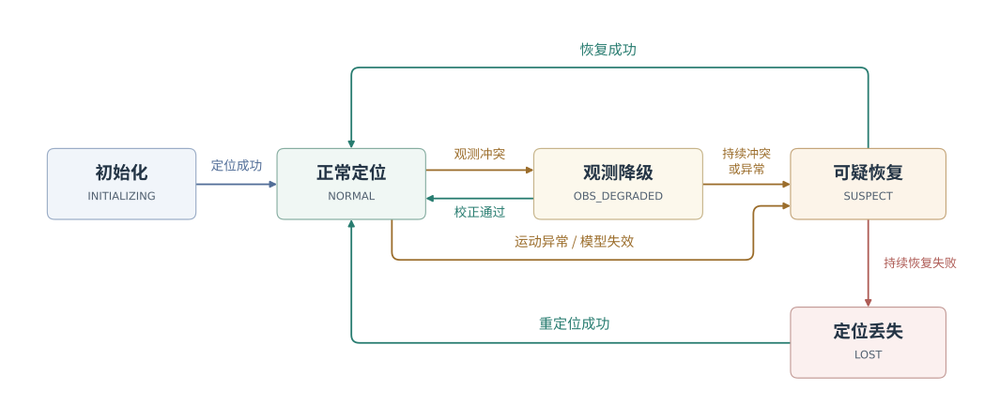

# Localization Backend · 定位后端


`backend` 是 [Z-Localization](../../README.md) 的定位后端，将前端里程计与先验地图、回环、UWB 位置观测结合，
输出全局位姿、速度、协方差和定位状态。包内也提供地图处理与车体外参标定工具。
除 ZLIO 外，其他 LIO 前端及奥丁之眼等定位模块也可通过里程计与点云兼容接口适配接入。

[项目结构](#项目结构) · [环境与依赖](#环境与依赖) · [快速开始](#快速开始) · [参数配置](#参数配置) · [对外接口](#对外接口) · [地图与标定工具](#地图与标定工具) · [致谢](#致谢)

## 项目结构

```text
src/backend/
├── README.md
├── include/backend/             核心接口、配置与数据类型
├── src/                         因子图、配准、回环、重定位与 UWB 融合
├── apps/                        ROS 输入、参数、服务与发布
├── tools/                       地图处理和车体外参标定
├── launch/
│   ├── backend.launch.py        定位后端启动入口
│   └── body_calibration.launch.py  车体外参标定入口
├── rviz/backend.rviz            RViz 配置
├── docs/
│   ├── parameters.md            完整参数列表与调参建议
│   └── assets/                  状态转移图
├── test/                        单元、集成、工具与 ROS 测试
├── CMakeLists.txt
└── package.xml
```

运行参数在 [backend.yaml](../../config/backend.yaml) 中配置。

## 环境与依赖

| 类别 | 依赖 |
| --- | --- |
| 系统环境 | Ubuntu 22.04、ROS 2 Humble |
| 编译与构建 | C++ ≥ 17、CMake ≥ 3.16、ament_cmake |
| C++ 库 | GTSAM 4.2.x、Eigen、PCL、nanoflann、oneTBB、OpenMP C++、Threads |
| ROS 包 | rclcpp、std_msgs、std_srvs、geometry_msgs、nav_msgs、sensor_msgs、visualization_msgs、tf2、tf2_ros、tf2_eigen、pcl_conversions、message_filters |
| 工作区包 | localization_interfaces |
| 启动与显示 | launch、launch_ros、ament_index_python、rviz2、PyYAML |
| 测试依赖 | ament_cmake_gtest、ament_cmake_pytest、launch_testing_ament_cmake、rclpy、rcl_interfaces、domain_coordinator、sensor_msgs_py、NumPy |

## 快速开始

```bash
# 建图
ros2 launch backend backend.launch.py config_file:=/absolute/path/to/backend.yaml mode:=mapping

# 先验地图定位与可视化
ros2 launch backend backend.launch.py config_file:=/absolute/path/to/backend.yaml \
  mode:=localization prior_map:=/absolute/path/to/map_bundle rviz:=true

# 车体外参标定
ros2 launch backend body_calibration.launch.py
```

## 参数配置

完整参数列表与调参建议见 [参数文档](docs/parameters.md)。

## 对外接口

### 输入话题

下表列出默认话题名。`common.frontend` 决定使用哪组接口，话题名可分别配置。ZLIO 消息定义见
[localization_interfaces](../localization_interfaces/README.md)。

| 话题 | 类型 | QoS | 内容 / 条件 |
| --- | --- | --- | --- |
| `/frontend/frame` | `localization_interfaces/msg/FrontendFrame` | reliable，50 | `zlio` 模式下，同一次观测的位姿与局部去畸变点云 |
| `/frontend/odometry` | `localization_interfaces/msg/FrontendOdometry` | reliable，200 | `zlio` 模式的高频预测 |
| `/frontend/session` | `localization_interfaces/msg/FrontendSession` | reliable，1，transient local | `zlio` 模式的进程身份、代次、恢复请求与处理失败通知 |
| `/Odometry_scan_end` | `nav_msgs/msg/Odometry` | best effort，50 | `legacy` 模式用于同步的里程计 |
| `/cloud_registered` | `sensor_msgs/msg/PointCloud2` | best effort，50 | `legacy` 模式用于同步的点云 |
| `/Odometry` | `nav_msgs/msg/Odometry` | SensorDataQoS | `legacy` 模式的高频里程计 |
| `/uwb_pose` | `geometry_msgs/msg/PoseStamped` | reliable，10 | UWB 天线在 `uwb.frame` 坐标系中的原始位置；由 `uwb.enabled` 启用 |

输入位姿以 `common.odom_frame` 为参考，描述 `common.sensor_frame` 的位置和姿态。
ZLIO 点云位于传感器坐标系，时间戳须与同一消息内的里程计一致。

### 输出话题

`~/` 在默认节点名下表示 `/backend_node/`。QoS 中的数字表示 keep-last 队列深度；
未标注 transient local 的话题使用 volatile，不向新订阅者补发历史消息。

| 话题 | 类型 | QoS | 内容 / 条件 |
| --- | --- | --- | --- |
| `/localization/odometry` | `nav_msgs/msg/Odometry` | reliable，200 | `zlio` 模式的 map 系传感器位姿、传感器系速度及协方差 |
| `~/localization_pose` | `geometry_msgs/msg/PoseWithCovarianceStamped` | reliable，20 | map 系车体位姿及协方差 |
| `~/localization_state` | `std_msgs/msg/String` | reliable，1，transient local | 定位状态、可信标记、代次、输出版本及故障信息 |
| `/localization/lio_world_cloud` | `sensor_msgs/msg/PointCloud2` | reliable，1 | map 系实时点云；由 `output.world_cloud` 控制 |
| `~/prior_map` | `sensor_msgs/msg/PointCloud2` | reliable，1，transient local | 先验地图显示，由 `visualization.publish_prior_map` 控制 |
| `~/runtime_map` | `sensor_msgs/msg/PointCloud2` | reliable，1，transient local | 运行地图显示，由 `visualization.publish_runtime_map` 控制 |
| `~/odom_path` | `nav_msgs/msg/Path` | reliable，1，transient local | 本次前端重置后的原始里程计轨迹，已转换到 map 系；由 `visualization.publish_paths` 控制 |
| `~/optimized_path` | `nav_msgs/msg/Path` | reliable，1，transient local | map 系优化轨迹；由 `visualization.publish_paths` 控制 |
| `~/loop_edges` | `visualization_msgs/msg/Marker` | reliable，1，transient local | 回环连线；由 `visualization.publish_paths` 控制 |
| `~/map_axes` | `visualization_msgs/msg/Marker` | reliable，1，transient local | 地图关键帧坐标轴；由 `visualization.publish_map_axes` 控制 |
| `~/uwb_position` | `visualization_msgs/msg/Marker` | reliable，1，transient local | UWB 推算的 map 系车体位置；由 `visualization.enabled` 控制 |
| `~/localization_status` | `visualization_msgs/msg/Marker` | reliable，1，transient local | 定位状态文字标记；由 `visualization.enabled` 控制 |
| `~/debug/aligned_source` | `sensor_msgs/msg/PointCloud2` | reliable，1，transient local | 最近一次配准后的源点云；由 `visualization.publish_debug_registration` 控制 |
| `~/debug/target` | `sensor_msgs/msg/PointCloud2` | reliable，1，transient local | 最近一次配准的目标点云；由 `visualization.publish_debug_registration` 控制 |
| `/tdt_lio_pose` | `geometry_msgs/msg/PoseStamped` | SensorDataQoS | 兼容车体位姿；由 `output.legacy.publish_pose` 控制 |
| `/tdt_lio_twist` | `geometry_msgs/msg/TwistStamped` | SensorDataQoS | 兼容车体速度，在 map 系表达；由 `output.legacy.publish_twist` 控制 |
| `/tdt_lio_path` | `nav_msgs/msg/Path` | reliable，1 | 兼容路径；由 `output.legacy.publish_path` 控制 |
| `/LAM_danger_situation` | `std_msgs/msg/Int16` | reliable，2 | 兼容危险码：可信状态为 `0`，其余为 `9` |
| `/tf` | `tf2_msgs/msg/TFMessage` | tf2 默认 QoS | map → odom；兼容输出可另发布 map → body |

兼容输出的总开关为 `output.legacy.enabled`，话题名通过 `output.legacy.*_topic` 配置。

### 标定与 ROS 通用话题

| 话题 | 类型 | 方向 / 条件 |
| --- | --- | --- |
| `/odometry` | `nav_msgs/msg/Odometry` | 车体标定节点订阅，SensorDataQoS；由标定参数 `odom_topic` 配置 |
| `/tf`、`/tf_static` | `tf2_msgs/msg/TFMessage` | 标定节点与 RViz 订阅；标定节点按里程计时刻查询 map → odom |
| `/clicked_point` | `geometry_msgs/msg/PointStamped` | RViz 的选点工具发布 |
| `/clock` | `rosgraph_msgs/msg/Clock` | 使用仿真时间时订阅 |
| `/parameter_events` | `rcl_interfaces/msg/ParameterEvent` | ROS 参数事件 |
| `/rosout` | `rcl_interfaces/msg/Log` | 节点日志 |

标定结果会在终端显示，并给出可填入 YAML 的配置片段。

### 服务

| 服务 | 类型 | 方向 / 含义 |
| --- | --- | --- |
| `~/save_map` | `std_srvs/srv/Trigger` | 保存运行轨迹地图包至 `trajectory.save_directory`；用于建图模式 |
| `~/relocalize` | `std_srvs/srv/Trigger` | 在 `LOST` 状态下请求重定位，收到新的有效帧后执行 |
| `/localization_reset` | `std_srvs/srv/Trigger` | 发起前后端协调重置；`success=true` 表示请求已接受 |
| `/zlio/reset_internal` | `localization_interfaces/srv/ResetFrontend` | 后端调用的前端重置服务，由 `reset.service` 配置 |

手动调用 `/localization_reset` 时，若前端无法提供暖重置前后的坐标变换，后端会按机器人保持静止来衔接位姿。
因此，调用时须保证整个重置期间停车。自动冷恢复需要重新通过先验地图匹配或 UWB 对齐确定全局位姿；
已有轨迹、且无绝对定位来源的纯建图模式会保持 `LOST`。
普通前端处理失败会使后端冻结输出，等待显式重置或新前端进程接入，不会自动反复重启。

### 定位状态

[](docs/assets/state-transitions.svg)

| 状态 | 含义 | `pose_trusted` |
| --- | --- | --- |
| `INITIALIZING` | 等待建立初始全局位姿 | `false` |
| `NORMAL` | 正常定位 | `true` |
| `OBS_DEGRADED` | 全局观测与预测冲突，但连续次数未达到阈值，继续信任当前位姿 | `true` |
| `SUSPECT` | 连续观测冲突、速度异常或匹配模型不再适用，正在尝试恢复 | `false` |
| `LOST` | 定位丢失，等待或尝试重定位 | `false` |

`localization_state` 使用分号分隔的 `key=value` 文本，包含定位状态、可信标记、重置代次和故障信息。
进入 `SUSPECT` 或 `LOST` 后，若已有可信位姿，输出会冻结在该位姿；兼容话题和世界点云是否继续发布由各自开关决定。

## 地图与标定工具

| 程序 | 功能 |
| --- | --- |
| `build_pcd_map_bundle` | 从全局 PCD 模拟局部扫描，生成关键帧与描述子地图包 |
| `transform_map_bundle` | 通过刚体变换、四点定轴或目标地图配准转换地图坐标 |
| `filter_map_bundle` | 依据参考点云过滤关键帧，或导出参考地图 |
| `clean_map_bundle` | 根据多帧扫描记录的可见空间，清理动态物体留下的地图残影 |
| `rebuild_scan_context_descriptors` | 重建地图包中的 Scan Context 描述子 |
| `body_calibration_node` | 标定传感器到车体的旋转及水平偏移 |

先验地图须使用关键帧地图包，包含 `keyframes.txt`、`clouds/` 和所选描述子的数据文件。
`map.pcd` 是可选的全局显示点云。各工具选项见[参数文档](docs/parameters.md#离线工具参数)。

## 致谢

感谢以下开源项目与研究工作提供的算法思路和工程参考。

| 项目 / 研究工作 | 参考与启发 |
| --- | --- |
| [GTSAM / iSAM2](https://github.com/borglab/gtsam) | 因子图建模、增量求解与边缘协方差计算 |
| [Scan Context](https://github.com/gisbi-kim/scancontext) / [Scan Context++](https://github.com/gisbi-kim/scancontext_tro) | 地点描述子、航向匹配与平移增强检索 |
| [G-PROBE](https://arxiv.org/abs/2607.06782v1) | 跨视场地点识别、概率占据描述与航向候选验证 |
| [PCM](https://github.com/MIT-SPARK/Kimera-RPGO#related-publications) | 回环测量的成对一致性与一致集合筛选思路 |
| [FreeDOM](https://github.com/LC-Robotics/FreeDOM) | 基于保守自由空间与可见性证据的动态残影清理 |

同时感谢 ROS 2、PCL、Eigen、nanoflann、oneTBB 和 OpenMP 生态的维护者。

## 维护者

mozihe · [zhujunheng2005@gmail.com](mailto:zhujunheng2005@gmail.com)

## 许可证

见 [LICENSE](../../LICENSE)。第三方组件保留各自许可证。
